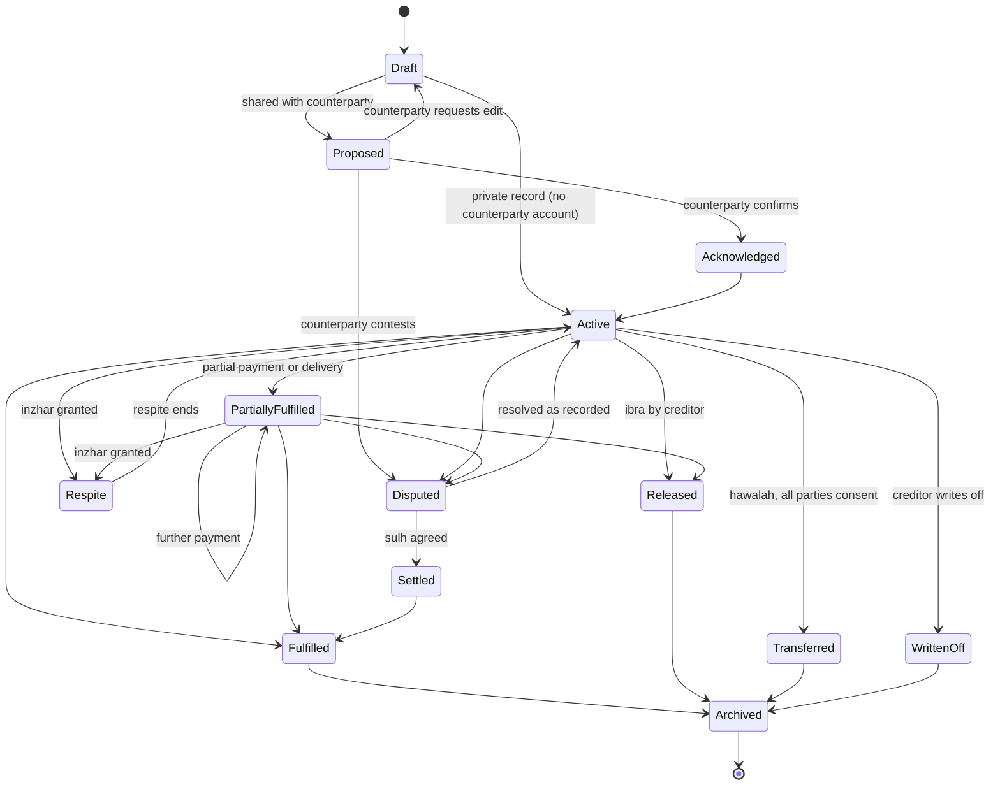
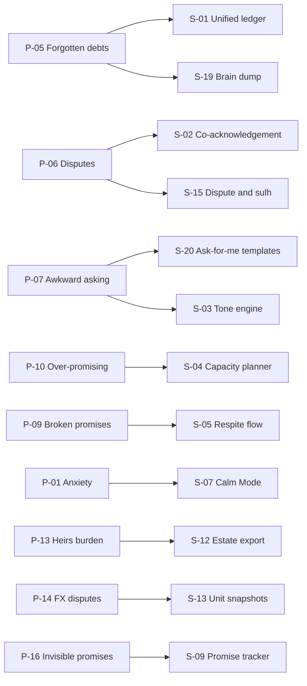
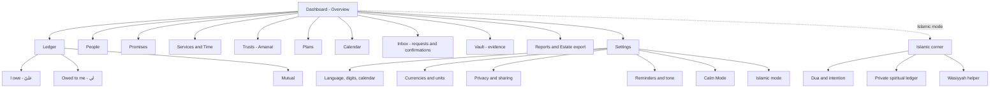
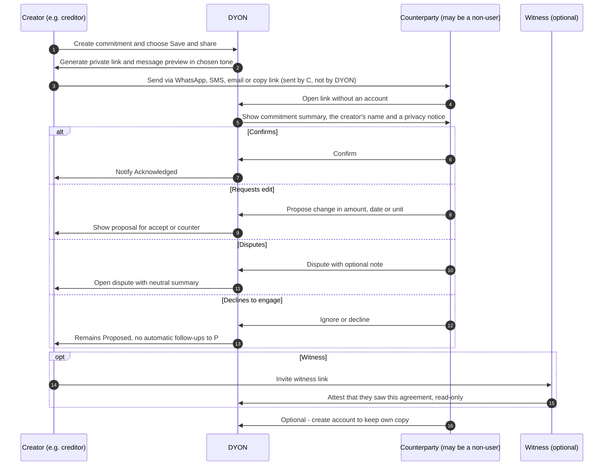
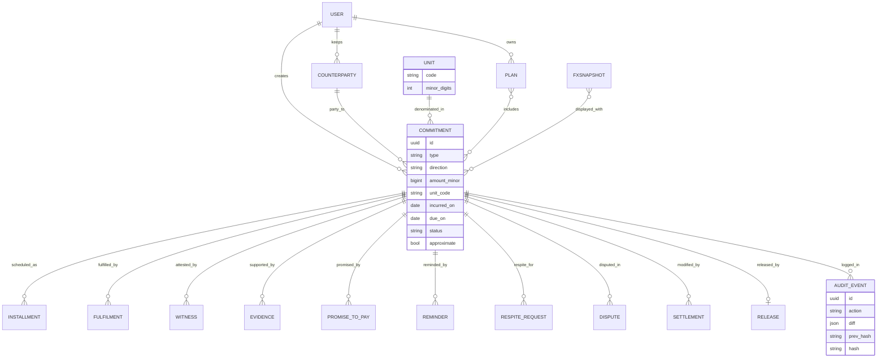

# DYON — ديون

### The Commitments Ledger: money, services, promises and trusts

| Field                      | Value                                                                                                                                                                                                                                                      |
| -------------------------- | ---------------------------------------------------------------------------------------------------------------------------------------------------------------------------------------------------------------------------------------------------------- |
| **Document**         | DYON Canonical Specification: Source of Truth                                                                                                                                                                                                              |
| **Version**          | v0.1                                                                                                                                                                                                                                                       |
| **Date**             | 2026-10-10                                                                                                                                                                                                                                                 |
| **Status**           | Canonical: Source of Truth                                                                                                                                                                                                                                 |
| **Owner**            | Founder                                                                                                                                                                                                                                                    |
| **Editorial method** | MetaX.Academy altitudes (Meta · Macro · Pro) and shared DNA (Sidq, Falsifiability, Declared limits, Correctability)                                                                                                                                      |
| **Licence note**     | © Maher - Founder. All rights reserved during v0.x. Publication under Maher's License 2.3 (ML-2.3) is under consideration; see open question Q-01. DYON borrows the*method* of the MetaX estate and claims no affiliation with or endorsement by MetaX.Academy. |
| **Supersedes**       | All earlier descriptions, definitions, pitches and notes about DYON. Where any earlier text conflicts with this document, this document governs.                                                                                                           |

> **Consolidation notice.** This version gathers and replaces every previous description and definition of DYON. Earlier drafts defined DYON narrowly as a money-debt tracker. That definition is **retired**. DYON's canonical scope is now *every commitment owed by one party to another*: money, goods, services, time, promises, trusts and moral rights. It is global by design: multilingual, multi-currency and multi-unit.

> **Language authority rule.** For Islamic and fiqh terms, **Arabic is authoritative** and translations are explanatory. For product specification, **English and Arabic have equal editorial standing**. When the two conflict on a fiqh term, the Arabic governs. When they conflict on a product behaviour, the conflict is logged as a defect and resolved in the next version.

---

## How to read this document

Every major section is written at three altitudes, following the MetaX method:

| Icon | Altitude        | What it contains                                                                                                                                                                                                                         | Question it answers                                          |
| ---- | --------------- | ---------------------------------------------------------------------------------------------------------------------------------------------------------------------------------------------------------------------------------------- | ------------------------------------------------------------ |
| 🧭   | **Meta**  | Evidence class, confidence, decay and review interval,**falsifier** (what would prove this wrong), declared limits                                                                                                                 | *How much should you trust this, and when does it expire?* |
| 🌍   | **Macro** | Social and civilizational frame: effects on relationships, families, society, successors and non-users. Mapped to ML-2.3 Part H harm strata (I Cognitive · II Relational · III Economic · IV Material · V Reflexive · VI Successor) | *What does this do to people beyond the screen?*           |
| 🛠   | **Pro**   | Professional and operational level: concrete decisions, specs, requirements, data, UX                                                                                                                                                    | *What exactly do we build?*                                |

**Traceability IDs**

| Prefix  | Meaning                                    | Example                                 |
| ------- | ------------------------------------------ | --------------------------------------- |
| `P-`  | Problem (psychological, social, practical) | P-05 Forgotten debts                    |
| `S-`  | Solution                                   | S-01 Unified ledger                     |
| `W-`  | Dashboard widget                           | W-01 Net Position                       |
| `R-`  | Requirement                                | R-D07 Calm Mode hides totals            |
| `RL-` | Red line (non-negotiable)                  | RL-01 No riba                           |
| `Q-`  | Open question                              | Q-03 Legal weight of co-acknowledgement |
| `D-`  | Defect in this document                    | D-001                                   |
| `C-`  | Accepted correction                        | C-001                                   |

**Evidence classes used throughout**

| Class       | Meaning                                                                                                                                                      |
| ----------- | ------------------------------------------------------------------------------------------------------------------------------------------------------------ |
| **A** | Strong: meta-analytic or widely replicated                                                                                                                   |
| **B** | Moderate: multiple consistent studies, mostly correlational                                                                                                  |
| **C** | Weak: single study, contested replication, or small samples                                                                                                  |
| **D** | Conceptual: theory, anthropology, reasoned design argument                                                                                                   |
| **N** | Normative: Qur'anic text or hadith. Authenticity is graded by scholars of hadith. These texts bind conduct for believers, but they are not empirical claims. |

---

## Changelog & corrections

| Version | Date       | Change                                                                                                                                                             | Author  |
| ------- | ---------- | ------------------------------------------------------------------------------------------------------------------------------------------------------------------ | ------- |
| v0.1    | 2026-10-10 | First canonical version. Consolidates and supersedes all earlier descriptions. Expands scope from money to all commitments. Adds the full dashboard specification. | Founder |

| ID    | Correction                                                                                                                                                                                                                                                                                                                                                                  | Reason                                    | Status                                                       |
| ----- | --------------------------------------------------------------------------------------------------------------------------------------------------------------------------------------------------------------------------------------------------------------------------------------------------------------------------------------------------------------------------- | ----------------------------------------- | ------------------------------------------------------------ |
| C-001 | The du'a commonly quoted as "*ghalabat al-dayn wa qahr al-rijal*" is recorded in **Ṣaḥīḥ al-Bukhārī (6369)** as **«وضَلَعِ الدَّيْنِ وغَلَبَةِ الرِّجالِ»** ("the burden of debt and being overpowered by men"). The wording «غَلَبَةِ الدَّيْن» appears in other collections, e.g. al-Nasāʾī. | Sidq: the citation must match its source. | Accepted. Both wordings are shown in-app with their sources. |

---

## 0. Executive summary

### 0.1 Vision

A world where no one carries a ديْن (dayn) in silence, where every obligation between people is **written, honoured, and released** with dignity on both sides.

### 0.2 Mission

> **Turn every ديْن — money, service, promise or trust — from a hidden weight into a written, honoured, and released commitment.**

### 0.3 The origin

DYON was not conceived in a boardroom. It began with its founder, who carries many debts with many people. Some were money, some were favours, some were promises made in good faith that circumstance made hard to keep.

The founder noticed four things:

1. The heaviest part of debt is often not the amount. It is the **not-knowing**: who exactly, how much, since when, and whether the other person is quietly hurt.
2. Debts are **not only money**. A promised visit, an unfinished job, a borrowed book and an apology owed all weigh on the mind in the same way.
3. Lenders suffer too. Many are **too embarrassed to ask**, and relationships decay in the silence.
4. The Islamic tradition already holds a complete ethic of debt: write it down, bring witnesses, give respite, forgive when you can, and repay with excellence. Yet no everyday tool embodies that ethic.

DYON is the founder's answer to their own situation, built so that others don't have to carry theirs alone. This origin is stated openly because it is the project's first evidence and its first bias. The founder is designing for a pain they know personally, and must guard against assuming everyone feels it the same way (see Q-02).

### 0.4 What DYON is

| DYON**is**                             | Meaning                                                                                                                 |
| -------------------------------------------- | ----------------------------------------------------------------------------------------------------------------------- |
| A**personal ledger of commitments**    | Everything you owe and are owed: money, items, services, time, promises, trusts                                         |
| A**shared record** between two parties | Both sides can see, confirm, correct or dispute the same entry                                                          |
| A**calm, dignified reminder system**   | It helps people ask and remember without shame                                                                          |
| A**planning tool**                     | Realistic repayment plans with no interest                                                                              |
| A**release instrument**                | Forgiveness (إبراء, ibrāʾ), settlement (صلح, ṣulḥ) and respite (إنظار, inẓār) as first-class actions |
| A**successor-aware archive**           | What you owe and are owed, ready for your heirs or executor if you choose                                               |
| **Global**                             | Multilingual, multi-currency, multi-unit and culturally adaptive, with an optional Islamic mode                         |

### 0.5 What DYON is NOT

| DYON is**not**                                   | Why this matters                                                                                                            |
| ------------------------------------------------------ | --------------------------------------------------------------------------------------------------------------------------- |
| ❌ A**lender**                                   | DYON never lends money and never brokers loans.                                                                             |
| ❌ A**debt collector**                           | DYON never contacts anyone on a creditor's behalf except through messages the user writes or approves, and never pressures. |
| ❌ A**credit bureau**                            | No score leaves the user's device context. Nothing is shared with banks, employers or anyone else.                          |
| ❌ An**interest engine**                         | No riba (ربا), no compounding, no penalty interest, ever (RL-01).                                                        |
| ❌ A**shaming platform**                         | No public defaulter lists and no social exposure (RL-03).                                                                   |
| ❌ A**fatwa authority**                          | Islamic content is educational. Rulings belong to qualified scholars.                                                       |
| ❌ A**replacement for therapy or legal counsel** | DYON reduces friction. It does not treat illness or give legal advice.                                                      |

### 0.6 Altitudes

🧭 **Meta.** The core thesis is that **writing commitments down, sharing the record, and offering dignified paths to fulfilment or release will reduce debt-related distress and increase fulfilment rates.**

- **Evidence class:** D for the overall thesis, which is a design argument. Its components carry B–N.
- **Confidence:** moderate.
- **Review interval:** 6 months.
- **Falsifier:** see §10.4.

🌍 **Macro.** Debt is a social bond before it is a financial one (Graeber 2011; Mauss 1925). A tool that touches debt touches families, friendships and inheritance. DYON's main harm surfaces are **Stratum II Relational** (surveillance between people, coercion), **Stratum III Economic** (becoming a scoring or extraction machine) and **Stratum VI Successor** (heirs inheriting records and obligations).

🛠 **Pro.** MVP target: Arabic and English, multi-currency, quick add, co-acknowledgement, core dashboard, gentle reminders (see §9).

---

## 1. Definitions & canonical vocabulary

### 1.1 The word ديْن

**In language (لغةً).** *Dayn* (دَيْن) comes from the root د-ي-ن. The same root yields *dīn* (دِين: religion, judgment, requital) and *dayyān* (دَيّان: the Requiter). Classical lexicons (e.g. *Lisān al-ʿArab*) connect the root to submission, obligation and recompense. The language itself suggests a debt is a moral bond, not only a number.

**In fiqh (اصطلاحًا).** A *dayn* is **a liability established in the *dhimma*** (ذمة: the legal-moral "account" of a person), which the creditor has a right to claim. It arises from a loan, a sale on credit, wages, damages, dowry and similar causes. It differs from an *ʿayn* (عين), a specific object such as a particular borrowed car. Jurists define the terms with madhhab-specific nuances, and those nuances are a declared limit (§3.6).

**DYON's product definition (canonical).**

> A **ديْن** in DYON is **any commitment owed by one party to another that is expected to be fulfilled**: money, goods, services, time, promises, trusts, or moral rights.

The product definition is deliberately **wider** than the fiqh definition. In-app, the Islamic mode distinguishes clearly between:

- a *dayn* in the strict fiqh sense;
- an *amānah* (trust);
- a *waʿd* (promise);
- a moral right (*ḥaqq*).

These differ in their rulings.

### 1.2 Glossary (canonical)

| Term (AR)                 | Transliteration         | Meaning                                          | Product meaning in DYON                                                                                                                                                   |
| ------------------------- | ----------------------- | ------------------------------------------------ | ------------------------------------------------------------------------------------------------------------------------------------------------------------------------- |
| دَيْن                | *dayn*                | Liability in the dhimma                          | A**Commitment** of type monetary or fungible                                                                                                                        |
| قرض حسن             | *qarḍ ḥasan*        | Benevolent loan repaid without increase          | Default model for every personal loan. No interest field exists.                                                                                                          |
| أمانة                | *amānah*             | Trust: something held on another's behalf        | **Trusts module**: items or money held for someone, with return expectation                                                                                         |
| وعد                    | *waʿd*               | Promise (unilateral)                             | **Promises module**: commitments to do something                                                                                                                    |
| عهد                    | *ʿahd*               | Covenant, pledge                                 | High-weight promise, marked "covenant" by the user                                                                                                                        |
| عقد                    | *ʿaqd*               | Contract (bilateral, binding)                    | A commitment with terms both parties acknowledged                                                                                                                         |
| كفالة                | *kafālah*            | Guarantee: a third party joins in responsibility | **Guarantor** role on a commitment                                                                                                                                  |
| حوالة                | *ḥawālah*           | Transfer of a debt to another debtor             | **Transfer flow**: requires consent of all parties                                                                                                                  |
| رهن                    | *rahn*                | Pledge or collateral                             | Optional**pledge note** (record only; DYON holds nothing)                                                                                                           |
| إنظار                | *inẓār*             | Respite: giving time to a debtor in hardship     | **Respite request and grant flow**                                                                                                                                  |
| إبراء                | *ibrāʾ*             | Release: discharging the debtor                  | **Release action** (full or partial), with a 24h undo guard                                                                                                         |
| صلح                    | *ṣulḥ*              | Amicable settlement                              | **Settlement proposal flow**                                                                                                                                        |
| مماطلة / مَطْل | *mumāṭalah / maṭl* | Delay in paying by someone who is able           | Concept in reminder logic: reminders differ for "able but delaying" vs "in hardship", always declared by the debtor themselves and never inferred by an algorithm (RL-07) |
| ربا                    | *ribā*               | Usury or interest, forbidden                     | **Never computed.** No field, no formula, no feature (RL-01)                                                                                                        |
| حقوق العباد     | *ḥuqūq al-ʿibād*  | Rights owed to people                            | The main ledger                                                                                                                                                           |
| حقوق الله         | *ḥuqūq Allāh*      | Rights owed to God                               | **Private spiritual ledger** (optional, Islamic mode, never shared)                                                                                                 |
| مظالم                | *maẓālim*           | Wrongs done to others                            | Moral and relational debts: apology, restitution                                                                                                                          |
| ذمة                    | *dhimma*              | Legal-moral capacity and account                 | Conceptual basis of "what is on me" (عليّ)                                                                                                                            |
| شاهد / شهادة     | *shāhid / shahādah* | Witness, testimony                               | **Witness role** on a commitment                                                                                                                                    |
| كتابة                | *kitābah*            | Writing down                                     | The founding act:**every commitment is written**                                                                                                                    |
| وصية                  | *waṣiyyah*           | Will, bequest instruction                        | **Estate export**: debts and trusts for heirs and executor                                                                                                          |
| نية                    | *niyyah*              | Intention                                        | **Intention pledge** (Islamic mode)                                                                                                                                 |
| وفاء                  | *wafāʾ*             | Fulfilment, loyalty                              | Status**Fulfilled** (تم الوفاء)                                                                                                                             |
| عُسرة / ميسرة   | *ʿusrah / maysarah*  | Hardship / ease                                  | Debtor's self-declared capacity state                                                                                                                                     |

### 1.3 Core entity terms

| Term                                           | Definition                                                                                                                                         | Notes                                                                                         |
| ---------------------------------------------- | -------------------------------------------------------------------------------------------------------------------------------------------------- | --------------------------------------------------------------------------------------------- |
| **Commitment** (ديْن / التزام) | The atomic record: who owes whom, what, by when, and its status                                                                                    | Every other object hangs off a Commitment                                                     |
| **Direction**                            | `I_OWE` (عليّ) · `OWED_TO_ME` (لي) · `MUTUAL` (متبادل)                                                                         | Mutual covers swaps and two-way obligations, shown netted only if the user chooses            |
| **Counterparty**                         | The other side:**person**, **group**, **institution**, **self** (self-promises), or **"Allah: private ledger only"** | The "Allah" counterparty exists only in Islamic mode, is device-private and never transmitted |
| **Unit**                                 | What is owed: ISO 4217 currency, gold or silver grams, hours, days, items, tasks, or custom                                                        | "A debt is owed in the unit it was created in" (§6.3)                                        |
| **Installment**                          | A scheduled partial fulfilment                                                                                                                     | No interest. The sum of installments must equal the principal.                                |
| **Promise-to-pay**                       | A debtor's dated statement of intent ("I will pay X by Y")                                                                                         | Separate from the due date. It records the debtor's own word.                                 |
| **Witness**                              | A person invited to see and attest a commitment                                                                                                    | Read-only. Cannot edit. Optional.                                                             |
| **Evidence**                             | Attachments: receipts, transfer screenshots, chat excerpts, voice notes                                                                            | Stored encrypted in the Vault                                                                 |
| **Settlement** (ṣulḥ)                  | Agreed modification of terms (amount, unit, or schedule)                                                                                           | Requires both parties                                                                         |
| **Release** (ibrāʾ)                    | Creditor discharges the debtor, fully or partly                                                                                                    | Irreversible after a 24h cooling-off (RL-10)                                                  |
| **Status lifecycle**                     | The defined states of a commitment                                                                                                                 | §1.5                                                                                         |

### 1.4 Taxonomy of ديون types

| #    | Type (EN / AR)                                                                              | Typical unit              | Islamic note                                                                                                             | Example                                 | Sensitivity                                            |
| ---- | ------------------------------------------------------------------------------------------- | ------------------------- | ------------------------------------------------------------------------------------------------------------------------ | --------------------------------------- | ------------------------------------------------------ |
| T-01 | **Monetary loan** / قرض نقدي                                                   | Currency                  | *Qarḍ*; any stipulated increase is riba                                                                               | "Borrowed 2,000 EGP from my cousin"     | Medium                                                 |
| T-02 | **Credit purchase / bill** / شراء بالأجل / فاتورة                     | Currency                  | Deferred sale is permissible; late-penalty interest is not                                                               | "Grocery shop tab, 340 MAD"             | Low                                                    |
| T-03 | **Wages & dues** / أجور ومستحقات                                          | Currency                  | "Give the worker his wage before his sweat dries" (Ibn Mājah 2443; graded acceptable by many through supporting chains) | "Owe the painter for 3 days"            | High (livelihood)                                      |
| T-04 | **In-kind / borrowed items** / عارية وأعيان                                | Items                     | *ʿĀriyah* (loan of use) must be returned                                                                             | "Neighbour's drill, the book from Ali"  | Low                                                    |
| T-05 | **Services & labour** / خدمات وأعمال                                       | Hours, tasks              | Hired labour (*ijārah*) or favour                                                                                     | "I promised to build his website"       | Medium                                                 |
| T-06 | **Time & favours** / وقت ومعروف                                              | Hours, occasions          | Virtue of reciprocity                                                                                                    | "She covered my shift twice"            | Low                                                    |
| T-07 | **Promises & commitments** / وعود والتزامات                              | Custom (done or not done) | *Waʿd*; scholars differ on whether it is legally binding, and many hold it morally binding                            | "Promised to visit grandmother monthly" | Medium                                                 |
| T-08 | **Trusts held** / أمانات                                                        | Items, currency           | *Amānah* must be returned (4:58)                                                                                      | "Holding my brother's savings"          | High                                                   |
| T-09 | **Moral & relational debts** / حقوق معنوية ومظالم                     | Custom                    | *Maẓālim*: seek pardon or restore the right                                                                          | "I owe Khalid an apology"               | **Very high**                                    |
| T-10 | **Spiritual debts to Allah** / حقوق الله                                      | Days, acts, amounts       | Missed fasts (qaḍāʾ),*kaffārāt*, *nadhr*, unpaid zakat. Rulings vary by madhhab.                                | "6 days of Ramadan to make up"          | **Very high**. Private, optional, off by default |
| T-11 | **Social reciprocity** / مجاملات اجتماعية                              | Occasions                 | Gifts and invitations (soft norm, not a debt in fiqh)                                                                    | "Their wedding gift, our turn"          | Low. Soft mode, no reminders by default                |
| T-12 | **Business & partnership obligations** / التزامات تجارية وشراكات | Currency, tasks           | *Sharikah* duties                                                                                                      | "Partner's share of rent"               | Medium                                                 |
| T-13 | **Inherited debts of the deceased** / ديون الميت                             | Currency, items           | Debts are paid from the estate before inheritance is distributed (4:11–12, "after any bequest or debt")                 | "Father's unpaid loan to his friend"    | **Very high**                                    |

### 1.5 Status lifecycle



| State               | AR                      | Meaning                                              | Who can trigger                                                                       |
| ------------------- | ----------------------- | ---------------------------------------------------- | ------------------------------------------------------------------------------------- |
| Draft               | مسودة              | Being written                                        | Creator                                                                               |
| Proposed            | مقترح              | Sent for confirmation                                | Creator                                                                               |
| Acknowledged        | مُقَرّ به       | Both parties confirmed                               | Counterparty                                                                          |
| Active              | قائم                | In force                                             | System, on acknowledgement or private save                                            |
| Partially fulfilled | وُفّي جزئيًا | Some paid or delivered                               | Either party records; the other confirms                                              |
| Respite             | إنظار              | Time granted                                         | Creditor                                                                              |
| Disputed            | متنازع عليه   | Disagreement recorded                                | Either party                                                                          |
| Settled             | صُولِح عليه   | Terms modified by agreement                          | Both                                                                                  |
| Fulfilled           | تم الوفاء       | Completely honoured                                  | Creditor confirms (or debtor, with evidence, if private)                              |
| Released            | أُبرئت الذمة | Forgiven                                             | Creditor only                                                                         |
| Transferred         | مُحال              | Moved to another debtor                              | All three parties                                                                     |
| Written off         | مُسقَط            | Creditor stops expecting it,*without* forgiving it | Creditor only. Distinct from Release; this distinction is a design decision, see Q-06 |
| Archived            | مؤرشف              | Closed and stored                                    | Either party, on their own view                                                       |

🧭 **Meta.**

- **Evidence class:** D (vocabulary design), N (fiqh terms).
- **Review interval:** 12 months, or sooner when a scholar review files a correction.
- **Falsifier:** if usability tests show that more than 30% of users mis-classify common entries (e.g. trusts filed as loans) after onboarding, the taxonomy is too fine. Merge types and keep the fiqh distinctions as optional tags.
- **Declared limit:** the product definition is wider than fiqh. DYON never claims that a "promise" in the app carries the ruling of a *dayn*.

🌍 **Macro.** Vocabulary is power. Forcing every culture's notion of obligation into "loan / repayment" is **HX-25 linguistic flattening**. Locales may carry native terms (§6.2). Including spiritual debts risks **HX-05 ambient surveillance** of private worship, so T-10 is device-private, opt-in and never synced without explicit consent.

🛠 **Pro.**

- **R-V01:** Type, Direction, Unit and Status are enums with stable codes. Labels are localized and never hard-coded.
- **R-V02:** Written-off and Released are distinct states with distinct copy.
- **R-V03:** T-10 records are excluded from all sync, export and analytics unless the user opts in per record.

---

## 2. The psychology of debts: academic lens

> ⚠️ **Disclaimer (Sidq).** The research below is summarized carefully but must be verified against the original sources before being quoted publicly. Most findings linking debt to health are **correlational**. Causality runs in both directions (poor health can cause debt) and is debated. Some cognitive findings have contested replications. DYON designs *for* these mechanisms. It does not claim to have proven them.

### 2.1 Health and mental health

| Source                                                                    | Finding (summarized)                                                                                                                                                              | Evidence class | Caveat                                          |
| ------------------------------------------------------------------------- | --------------------------------------------------------------------------------------------------------------------------------------------------------------------------------- | -------------- | ----------------------------------------------- |
| Richardson, Elliott & Roberts (2013),*Clinical Psychology Review* 33(8) | Systematic review and meta-analysis: unsecured debt is associated with mental disorder, depression, suicide completion and ideation, problem drinking, and poorer physical health | **A/B**  | Mostly cross-sectional. Heterogeneous measures. |
| Jenkins et al. (2008),*Psychological Medicine* 38(10)                   | In a UK national survey, debt was associated with mental disorder even after adjusting for income                                                                                 | **B**    | Cross-sectional                                 |
| Sweet, Nandi, Adam & McDade (2013),*Social Science & Medicine* 91       | Higher debt-to-asset ratio associated with higher perceived stress, depression and diastolic blood pressure, and worse self-reported health                                       | **B**    | US young-adult cohort. Single population.       |

### 2.2 Cognition and decision-making

| Source                                                                                              | Mechanism                                                                                                             | Evidence class | Caveat                                                               |
| --------------------------------------------------------------------------------------------------- | --------------------------------------------------------------------------------------------------------------------- | -------------- | -------------------------------------------------------------------- |
| Mullainathan & Shafir (2013),*Scarcity*                                                           | **Tunneling** (focus narrows onto the urgent) and a **bandwidth tax** (scarcity consumes mental capacity) | **B/D**  | Popular synthesis of many studies                                    |
| Mani, Mullainathan, Shafir & Zhao (2013),*Science* 341                                            | Financial worry reduced cognitive performance; farmers performed better after harvest than before                     | **C**    | Replication results are mixed                                        |
| Karlsson, Loewenstein & Seppi (2009),*Journal of Risk and Uncertainty* 38                         | **Ostrich effect**: people avoid looking at information they expect to be bad                                   | **B**    | Original data on portfolio checking                                  |
| Zeigarnik (1927) and later literature                                                               | **Open loops**: unfinished tasks stay mentally active                                                           | **C**    | Replications are inconsistent. Use as a design heuristic, not a law. |
| Laibson (1997),*QJE* 112(2)                                                                       | **Present bias / hyperbolic discounting**: overweighting now versus later                                       | **A/B**  | Robust in many settings                                              |
| Kahneman & Tversky (1979),*TIMS Studies in Management Science* 12; Buehler, Griffin & Ross (1994) | **Planning fallacy**: systematic underestimation of time and cost                                               | **A/B**  | Robust                                                               |
| Thaler (1999),*Journal of Behavioral Decision Making* 12(3)                                       | **Mental accounting**: money is treated differently by mental "bucket"                                          | **B**    | Robust as a framework                                                |
| Gathergood (2012),*Journal of Economic Psychology* 33(3)                                          | Self-control problems and low financial literacy are associated with over-indebtedness                                | **B**    | UK sample. Correlational.                                            |

### 2.3 Emotion, relationships and society

| Source                                                 | Mechanism                                                                                                                                                            | Evidence class                            |
| ------------------------------------------------------ | -------------------------------------------------------------------------------------------------------------------------------------------------------------------- | ----------------------------------------- |
| Tangney & Dearing (2002),*Shame and Guilt*           | **Shame** ("I am bad") drives hiding and avoidance. **Guilt** ("I did something bad") drives repair. Design should evoke guilt-like repair, never shame. | **B**                               |
| Gouldner (1960),*American Sociological Review* 25(2) | **Norm of reciprocity**: an unreturned benefit creates an obligation and tension                                                                               | **D/B**                             |
| Mauss (1925),*Essai sur le don*                      | Gifts create bonds of obligation: to give, to receive, to return                                                                                                     | **D**                               |
| Graeber (2011),*Debt: The First 5,000 Years*         | Debt is a moral and social relation, historically tied to power, honour and violence                                                                                 | **D** (contested historical claims) |

### 2.4 Creditor-side psychology

The lender's suffering is rarely discussed:

- **Embarrassment to ask.** Asking feels like accusing, and many lenders never ask (D/B, consistent with reciprocity and face-saving literature).
- **Silent resentment.** Unspoken losses corrode friendship more than the money itself (D).
- **Role confusion.** Being friend, family member and creditor at once creates conflicting scripts (D).
- **Fear of being seen as greedy**, especially where generosity is a core virtue (D).
- **Ambiguity of status.** Lenders cannot tell if the debtor has forgotten, is struggling, or is avoiding (D).

### 2.5 Problems register

| ID             | Problem                                                             | Mechanism                                                          | Evidence                   | Who it hurts            |
| -------------- | ------------------------------------------------------------------- | ------------------------------------------------------------------ | -------------------------- | ----------------------- |
| **P-01** | Chronic anxiety & rumination                                        | Open loops; perceived lack of control                              | B                          | Debtor                  |
| **P-02** | Shame, hiding, avoidance                                            | Shame response; ostrich effect                                     | B                          | Debtor, relationship    |
| **P-03** | Cognitive bandwidth tax                                             | Scarcity and tunneling                                             | B/C                        | Debtor, family          |
| **P-04** | Sleep loss and physical health strain                               | Stress pathway (associated with blood pressure, self-rated health) | B                          | Debtor                  |
| **P-05** | Memory loss and forgotten debts ("I don't remember who I owe")      | No written record; many small obligations; time decay              | D (founder lived evidence) | Debtor, creditor        |
| **P-06** | Disputes over amounts and dates                                     | No writing, no witnesses (the very problem 2:282 addresses)        | D/N                        | Both, relationship      |
| **P-07** | Relationship erosion and awkwardness of asking                      | Reciprocity tension; face-saving                                   | D/B                        | Relationship            |
| **P-08** | Creditor resentment and silent losses                               | Unasked claims; ambiguity                                          | D                          | Creditor, relationship  |
| **P-09** | Lying and broken promises under pressure                            | Avoidance under stress (named explicitly in Bukhari 832)           | N/D                        | Both, trust             |
| **P-10** | Over-promising repayment dates                                      | Planning fallacy; present bias                                     | A/B                        | Both                    |
| **P-11** | Debt spiral: new debt to pay old                                    | Tunneling; short-term relief                                       | B                          | Debtor, society         |
| **P-12** | Isolation                                                           | Shame leads to withdrawal from social ties                         | B/D                        | Debtor                  |
| **P-13** | Burden on family and heirs after death                              | Unrecorded debts; disputed estates                                 | N/D                        | Successors              |
| **P-14** | Currency and inflation disputes                                     | Revaluation ambiguity in multi-currency lives                      | D                          | Both, diaspora          |
| **P-15** | Power imbalance and coercion                                        | Debt used as leverage (Graeber;*ghalabat al-rijāl*)             | D/N                        | Debtor                  |
| **P-16** | Invisible non-monetary debts (promises, services) cause trust decay | Unrecorded, untracked; reciprocity violations                      | D                          | Relationship, community |

🧭 **Meta.**

- **Review interval:** 12 months (literature refresh).
- **Falsifier:** if DYON's own Phase 0 interviews (n ≥ 30 debtors, n ≥ 15 creditors) find that P-05 (forgotten debts) and P-07 (awkwardness of asking) are rated low-importance by more than 70% of participants, re-prioritize the MVP away from memory and asking flows.
- **Declared limit:** this register reflects mostly WEIRD-sample research (Western, Educated, Industrialized, Rich, Democratic) plus Islamic normative sources. Debt experience in other cultures and informal economies is under-studied, so DYON must run its own cross-cultural research.

🌍 **Macro.** These are not only individual pains. P-11 and P-15 scale into **Stratum III Economic** harms (cycles of extraction). P-13 is a **Stratum VI Successor** harm. P-07, P-08 and P-16 are **Stratum II Relational**. They injure the social fabric that informal lending depends on, especially in communities excluded from formal credit (HX-13 exclusion by default).

🛠 **Pro.** Every P-xx must map to at least one S-xx (§4) and one W-xx (§7). Any problem without a mapped solution is shown as a defect in the governance register.

---

## 3. The Islamic lens on debts

> 🕌 **Respect and verification.** The texts below are presented with care and with their commonly cited references. Hadith numbering follows widely used editions (e.g. Fuʾād ʿAbd al-Bāqī numbering for Muslim) and **must be verified** by a qualified scholar before in-app publication. DYON is **not a fatwa authority**.

### 3.1 Qur'anic foundations

| Ref                                                                  | Text (AR)                                                                                                                                                                                                                                                                     | Meaning (EN, explanatory)                                                                                                                                                                                                                         | Theme                                 |
| -------------------------------------------------------------------- | ----------------------------------------------------------------------------------------------------------------------------------------------------------------------------------------------------------------------------------------------------------------------------- | ------------------------------------------------------------------------------------------------------------------------------------------------------------------------------------------------------------------------------------------------- | ------------------------------------- |
| **2:282** (*Āyat al-Dayn*, the longest verse in the Qur'an) | ﴿يَا أَيُّهَا الَّذِينَ آمَنُوا إِذَا تَدَايَنتُم بِدَيْنٍ إِلَىٰ أَجَلٍ مُّسَمًّى فَاكْتُبُوهُ ۚ وَلْيَكْتُب بَّيْنَكُمْ كَاتِبٌ بِالْعَدْلِ﴾ | "O you who believe, when you contract a debt for a fixed term, write it down, and let a scribe write it between you in justice…" The verse goes on to address witnesses, the debtor dictating, and not tiring of writing small or large amounts. | **Writing, witnesses, justice** |
| **2:280**                                                      | ﴿وَإِن كَانَ ذُو عُسْرَةٍ فَنَظِرَةٌ إِلَىٰ مَيْسَرَةٍ ۚ وَأَن تَصَدَّقُوا خَيْرٌ لَّكُمْ ۖ إِن كُنتُمْ تَعْلَمُونَ﴾                                                     | "If the debtor is in hardship, then grant respite until ease; and to remit it as charity is better for you, if you only knew."                                                                                                                    | **Respite, forgiveness**        |
| **2:283**                                                      | ﴿فَإِنْ أَمِنَ بَعْضُكُم بَعْضًا فَلْيُؤَدِّ الَّذِي اؤْتُمِنَ أَمَانَتَهُ وَلْيَتَّقِ اللَّهَ رَبَّهُ ۗ وَلَا تَكْتُمُوا الشَّهَادَةَ﴾              | Pledge when no scribe is available. "If one of you trusts another, let the trusted one render the trust… and do not conceal testimony."                                                                                                          | **Pledge, trust, testimony**    |
| **4:58**                                                       | ﴿إِنَّ اللَّهَ يَأْمُرُكُمْ أَن تُؤَدُّوا الْأَمَانَاتِ إِلَىٰ أَهْلِهَا﴾                                                                                                                                   | "God commands you to render trusts to their owners."                                                                                                                                                                                              | **Amānah**                     |
| **17:34**                                                      | ﴿وَأَوْفُوا بِالْعَهْدِ ۖ إِنَّ الْعَهْدَ كَانَ مَسْئُولًا﴾                                                                                                                                                              | "Fulfil the covenant; the covenant will be asked about."                                                                                                                                                                                          | **Promises**                    |
| **5:1**                                                        | ﴿يَا أَيُّهَا الَّذِينَ آمَنُوا أَوْفُوا بِالْعُقُودِ﴾                                                                                                                                                                       | "O you who believe, fulfil your contracts."                                                                                                                                                                                                       | **Contracts**                   |
| **61:2–3**                                                    | ﴿لِمَ تَقُولُونَ مَا لَا تَفْعَلُونَ ۝ كَبُرَ مَقْتًا عِندَ اللَّهِ أَن تَقُولُوا مَا لَا تَفْعَلُونَ﴾                                                                                | "Why do you say what you do not do? Most hateful to God is that you say what you do not do."                                                                                                                                                      | **Integrity of word**           |
| **23:8**                                                       | ﴿وَالَّذِينَ هُمْ لِأَمَانَاتِهِمْ وَعَهْدِهِمْ رَاعُونَ﴾                                                                                                                                                                | "Those who are watchful over their trusts and covenants."                                                                                                                                                                                         | **Trusts and covenants**        |
| **2:275–279**                                                 | ﴿وَأَحَلَّ اللَّهُ الْبَيْعَ وَحَرَّمَ الرِّبَا﴾ …                                                                                                                                                                               | "God has permitted trade and forbidden riba…", ending with "you shall not wrong, nor be wronged" (2:279).                                                                                                                                        | **Riba prohibition**            |
| **4:11–12**                                                   | ﴿مِن بَعْدِ وَصِيَّةٍ يُوصِي بِهَا أَوْ دَيْنٍ﴾                                                                                                                                                                                      | Inheritance shares are distributed "after any bequest or debt".                                                                                                                                                                                   | **Estate**                      |

### 3.2 Prophetic guidance (Hadith)

| Theme                                   | Text (AR)                                                                                                                                         | Meaning (EN)                                                                                                                                         | Source                                    |
| --------------------------------------- | ------------------------------------------------------------------------------------------------------------------------------------------------- | ---------------------------------------------------------------------------------------------------------------------------------------------------- | ----------------------------------------- |
| Debt leads to lying and broken promises | «اللهم إني أعوذ بك من المأثم والمغرم» … «إن الرجل إذا غرم حدّث فكذب، ووعد فأخلف» | He ﷺ often sought refuge from sin and debt, and explained that when a man is in debt, he speaks and lies, promises and breaks it.                   | Bukhārī 832; Muslim 589                 |
| Refuge from the weight of debt          | «…وضَلَعِ الدَّيْنِ وغَلَبَةِ الرِّجالِ»                                                                     | "…and from the burden of debt and being overpowered by men."                                                                                        | Bukhārī 6369 (see C-001)                |
| The soul is suspended                   | «نَفْسُ المؤمنِ مُعلَّقةٌ بدَيْنِه حتى يُقضى عنه»                                                      | "The soul of the believer is suspended by his debt until it is paid on his behalf."                                                                  | Tirmidhī 1078–1079; Ibn Mājah 2413     |
| Intention to repay                      | «من أخذ أموال الناس يريد أداءها أدّى الله عنه، ومن أخذ يريد إتلافها أتلفه الله»  | "Whoever takes people's wealth intending to repay it, God will repay on his behalf; whoever takes it intending to destroy it, God will destroy him." | Bukhārī 2387                            |
| Debt and the martyr                     | «يُغفر للشهيد كلُّ ذنبٍ إلا الدَّين»                                                                               | "The martyr is forgiven every sin except debt."                                                                                                      | Muslim 1886                               |
| Delay by the able                       | «مَطْلُ الغنيِّ ظُلمٌ»                                                                                                        | "Procrastination of the wealthy is injustice."                                                                                                       | Bukhārī 2287; Muslim 1564               |
| Excellence in repaying                  | «إنّ خيارَكم أحسنُكم قضاءً»                                                                                               | "The best of you are the best in repaying."                                                                                                          | Bukhārī 2305; Muslim 1600               |
| Signs of the hypocrite                  | «آيةُ المنافقِ ثلاثٌ: إذا حدّث كذب، وإذا وعد أخلف، وإذا اؤتُمن خان»                        | "The signs of a hypocrite are three: when he speaks he lies, when he promises he breaks it, and when trusted he betrays."                            | Bukhārī 33; Muslim 59                   |
| Funeral prayer and debt                 | «صلّوا على صاحبكم» …                                                                                                             | He ﷺ withheld the funeral prayer from a man who died in debt until Abū Qatādah guaranteed the debt.                                               | Bukhārī 2289 (and related)              |
| Respite to the one in hardship          | «من سرّه أن يُنجيه الله من كُرَب يوم القيامة فليُنفِّس عن مُعسرٍ أو يضع عنه»        | "Whoever would be pleased for God to save him from the distress of the Day of Resurrection, let him relieve one in hardship or remit for him."       | Muslim 1563                               |
| Ease to the one in difficulty           | «ومن يسّر على مُعسرٍ يسّر الله عليه في الدنيا والآخرة»                                               | "Whoever eases things for one in difficulty, God will ease things for him in this world and the next."                                               | Muslim 2699                               |
| Du'a for sufficiency                    | «اللهم اكفني بحلالك عن حرامك، وأغنني بفضلك عمّن سواك»                                                | "O God, suffice me with what You have made lawful against what You have forbidden, and enrich me by Your bounty from all besides You."               | Tirmidhī 3563 (graded*ḥasan* by many) |

### 3.3 The ethic in one line

> The Islamic ethic of debt is a **full cycle**: *write it* (kitābah) → *witness it* (shahādah) → *intend to repay* (niyyah) → *repay with excellence* (ḥusn al-qaḍāʾ) → *if unable, ask for respite* (inẓār) → *if able, don't delay* (no maṭl) → *creditor: forgive if you can* (ibrāʾ, taṣadduq) → *settle when you disagree* (ṣulḥ) → *never increase it* (no ribā) → *prepare for death* (waṣiyyah).
> 
> **DYON is an implementation of this cycle as software, available to everyone.**

### 3.4 Principle → app principle → feature

| Islamic principle                                             | App principle                                                       | DYON feature                                                                      | Linked S / W     |
| ------------------------------------------------------------- | ------------------------------------------------------------------- | --------------------------------------------------------------------------------- | ---------------- |
| **Kitābah** (2:282)                                    | Every commitment is written                                         | Unified ledger; co-acknowledged records                                           | S-01, S-02, W-01 |
| **Shahādah** (2:282–283)                              | Trust is strengthened by attestation                                | Witness role (invite, read-only, attest)                                          | S-02             |
| **"Do not tire of writing it, small or large"** (2:282) | No commitment is too small                                          | Quick add in ≤ 20s; micro-debts allowed                                          | §7.5            |
| **Niyyah** (Bukhārī 2387)                             | Intention matters and is recorded privately                         | **Intention pledge** (Islamic mode)                                         | S-17, W-18       |
| **Inẓār** (2:280)                                     | Hardship deserves time, not pressure                                | **Respite request and grant flow**                                          | S-05, W-12       |
| **Ibrāʾ / taṣadduq** (2:280; Muslim 1563)            | Forgiveness is a first-class action                                 | **Release** with optional sadaqah intention note and 24h undo               | S-06, W-11       |
| **Prohibition of ribā** (2:275–279)                   | No increase on debts                                                | No interest engine; late fees disabled; no penalty fields                         | RL-01            |
| **Maṭl al-ghanī ẓulm**                               | The able should not delay                                           | Reminders vary by the debtor's*self-declared* capacity; no algorithmic judgment | S-03, RL-07      |
| **Ḥusn al-qaḍāʾ**                                   | Repay well                                                          | **Gratitude receipt** on fulfilment; optional thank-you message             | S-18             |
| **Waṣiyyah** (4:11–12; Bukhārī 2289)                | Debts must not die with us                                          | **Estate export** for executor and heirs                                    | S-12, W-17       |
| **Amānah** (4:58; 23:8)                                | Trusts are sacred                                                   | **Trusts module** with return expectations                                  | S-11, W-09       |
| **Waʿd / ʿahd** (17:34; 61:2–3)                      | Promises are commitments                                            | **Promises module**                                                         | S-09, W-07       |
| **Ḥawālah / kafālah**                                | Debts may transfer or be guaranteed with consent                    | Transfer and guarantor flows (all-party consent)                                  | Phase 3          |
| **Ṣulḥ**                                              | Settlement is good (4:128: ﴿وَالصُّلْحُ خَيْرٌ﴾) | **Settlement proposals** with neutral summary                               | S-15             |
| **Al-maʾtham wal-maghram** (Bukhārī 832)             | Debt pressure leads to lying                                        | Never pressure; remove the*need* to lie (respite is easier than excuses)        | S-05, RL-05      |
| **Concealing testimony is forbidden** (2:283)           | Records must be honest and complete                                 | Append-only audit log; no silent edits                                            | §8.3            |

### 3.5 Islamic mode

- **Default:** faith-neutral. DYON is for **everyone**, of every faith or none.
- **Islamic mode (وضع إسلامي):** an optional *cultural* toggle that adds:
  - fiqh vocabulary labels;
  - verse and hadith micro-content on relevant screens;
  - the du'a and intention corner (W-18);
  - the private spiritual ledger (T-10);
  - Hijri dates in primary position;
  - the "Islamic-gentle" reminder tone.
- The toggle does **not** change obligations, amounts or rules. It changes framing and adds optional tools.
- Being in Islamic mode is never transmitted to counterparties, so it cannot be used to profile users (HX-05).

### 3.6 Altitudes

🧭 **Meta.**

- **Evidence class:** N (normative sources); D (feature mapping).
- **Review interval:** 12 months, plus mandatory review by at least two qualified scholars from different madhhabs before Phase 2 launch.
- **Declared limits:**
  1. Madhhabs differ on whether a *waʿd* is legally binding, on currency-value disputes, on gold-equivalence, on spiritual-debt calculations, and on other points.
  2. DYON presents differences; it does not adjudicate them.
  3. Hadith grading is reported as commonly cited, not independently verified by DYON.
- **Falsifier:** if scholar reviewers find that any feature misrepresents a ruling (e.g. "Release" copy implying obligations to Allah are discharged), the feature is pulled until corrected and a public correction is filed.

🌍 **Macro.** Religious framing can heal or wound. Used to shame ("you are a hypocrite for not paying"), it becomes **HX-22 persuasion asymmetry** weaponized with sacred authority. DYON therefore **never** shows hypocrisy-related hadith in reminders to a debtor. They appear only in self-chosen reflection content.

🛠 **Pro.**

- **R-I01:** Islamic content is stored in a reviewed content repository with source, grading and reviewer ID for each item.
- **R-I02:** No religious text is ever auto-inserted into a message sent to another person unless the sender explicitly selects it.
- **R-I03:** Both wordings in C-001 are shown with their respective sources.

---

## 4. From problems to solutions: the solution matrix

| S-ID           | Solution                                                                             | Addresses                    | Module         | Success metric                                                               | Falsifier                                                                                                             |
| -------------- | ------------------------------------------------------------------------------------ | ---------------------------- | -------------- | ---------------------------------------------------------------------------- | --------------------------------------------------------------------------------------------------------------------- |
| **S-01** | **Unified ledger** of all ديون (money, items, services, promises, trusts)  | P-05, P-01, P-16             | Ledger         | ≥ 80% of new users record ≥ 3 commitments in the first session             | If users record < 2 on average, the ledger isn't worth the effort. Simplify.                                          |
| **S-02** | **Co-acknowledged records**: both parties confirm, with optional witnesses     | P-06, P-08, P-09             | Shared records | ≥ 40% of shared commitments acknowledged within 7 days                      | If disputes per 100 acknowledged records ≥ disputes on private records, co-acknowledgement isn't preventing disputes |
| **S-03** | **Compassionate reminders** (tone engine, no shaming)                          | P-07, P-08, P-02             | Reminders      | Reminder opt-out < 10%/month                                                 | Opt-out > 25% means a tone failure                                                                                    |
| **S-04** | **Repayment planner with capacity check** (anti planning-fallacy)              | P-10, P-11, P-01             | Plans          | ≥ 60% of plan installments met on time                                      | If plan adherence is no better than unplanned promise-to-pay adherence, the planner adds nothing                      |
| **S-05** | **Respite (inẓār) & renegotiation**                                          | P-09, P-02, P-15             | Respite        | ≥ 50% of respite requests answered within 72h                               | If respite requests correlate with relationship-health drops, the flow itself is stigmatizing                         |
| **S-06** | **Release / forgiveness flow** (ibrāʾ)                                       | P-01, P-07, P-12             | Release        | Releases undone within 24h < 5%                                              | A high undo rate means people release impulsively. Strengthen the guard.                                              |
| **S-07** | **Calm Mode & wellbeing resources**                                            | P-01, P-02, P-03, P-04, P-12 | Calm           | Self-reported anxiety drops ≥ 1 point (on 1–5) over 8 weeks in Calm users  | No change, or a rise, means Calm Mode is cosmetic (HX-15)                                                             |
| **S-08** | **Clarity Score**: private, measures record completeness, not creditworthiness | P-05, P-01                   | Insights       | Clarity Score correlates with lower self-reported anxiety                    | If users experience it as a judgment (survey), remove the score and keep the checklist                                |
| **S-09** | **Promise tracker**                                                            | P-16, P-09, P-10             | Promises       | ≥ 50% of tracked promises marked kept or renegotiated (not silently lapsed) | If promises lapse silently at the same rate untracked, tracking is noise                                              |
| **S-10** | **Services & time ledger**                                                     | P-16, P-07                   | Services       | Freelancer persona: invoiceable hours recovered                              | No reported recovery after 3 months                                                                                   |
| **S-11** | **Trusts registry** (amānāt)                                                 | P-05, P-13                   | Trusts         | Trusts with return dates ≥ 70%                                              | No difference in returned-on-time rate                                                                                |
| **S-12** | **Estate / waṣiyyah export**                                                  | P-13                         | Estate         | ≥ 20% of users with ≥ 5 commitments generate an export                     | If heirs report exports were unusable (pilot), redesign                                                               |
| **S-13** | **Multi-currency snapshots** (unit fixed at creation; optional gold reference) | P-14                         | Currency       | FX-related disputes < 1 per 100 cross-currency commitments                   | If FX disputes don't decrease vs. baseline interviews                                                                 |
| **S-14** | **Evidence vault**                                                             | P-06, P-13                   | Vault          | ≥ 30% of commitments > a threshold amount have evidence attached            | —                                                                                                                    |
| **S-15** | **Dispute resolution with neutral summary** and ṣulḥ proposals               | P-06, P-07, P-15             | Disputes       | ≥ 60% of disputes reach Settled or Active (resolved) within 30 days         | If < 30%, the flow escalates conflict                                                                                 |
| **S-16** | **Snowball / avalanche / relationship-first strategies**, no interest          | P-11, P-03, P-10             | Plans          | Users with a strategy reach their first fulfilment faster                    | No difference                                                                                                         |
| **S-17** | **Intention pledge & du'a corner** (Islamic mode)                              | P-01, P-02                   | Islamic        | Optional usage; reflection reports                                           | If usage correlates with*increased* guilt or anxiety, reframe the content                                           |
| **S-18** | **Gratitude receipts** on fulfilment                                           | P-07, P-08                   | Fulfilment     | ≥ 30% of fulfilments followed by a thank-you                                | —                                                                                                                    |
| **S-19** | **Brain-dump onboarding** with guided memory prompts                           | P-05, P-01                   | Onboarding     | Median ≥ 5 commitments recalled in onboarding                               | If < 2, the prompts aren't working                                                                                    |
| **S-20** | **"Ask for me" templates** for creditors                                       | P-07, P-08                   | Reminders      | Creditors who use templates report less awkwardness                          | No difference in survey                                                                                               |



🧭 **Meta.**

- **Evidence class:** D (design hypotheses). Every metric must be measured, not assumed.
- **Review interval:** quarterly after launch.
- **Declared limit:** a metric achieved is not proof of wellbeing. Fulfilment can rise because users feel pressured, which would be a harm. Fulfilment metrics must therefore always be read **together with** anxiety and relationship metrics.

🌍 **Macro.** Optimizing "fulfilment rate" alone would turn DYON into a soft collector (**HX-09 metric colonisation**). The north-star is **paired**: fulfilment ↑ **and** anxiety ↓ **and** relationship-health stable or improving.

🛠 **Pro.** Each S-xx ships with:

- an analytics event spec;
- a privacy review;
- a falsifier dashboard, reviewed monthly.

---

## 5. Product principles & red lines

### 5.1 Principles (inherited DNA)

| Principle                              | DYON meaning                                                                               | Failure condition                                                       |
| -------------------------------------- | ------------------------------------------------------------------------------------------ | ----------------------------------------------------------------------- |
| **Sidq** (صدق, truthfulness)  | Records never lie. History is append-only. Copy never overstates (e.g. "legally binding"). | A record changes without trace, or marketing claims outcomes unmeasured |
| **Falsifiability**               | Every feature states what would prove it doesn't work                                      | A feature ships without a falsifier                                     |
| **Declared limits**              | Every screen with legal, religious or health content states what it cannot do              | Advice-like content without a limit notice                              |
| **Correctability**               | Public changelog and defect register; users can file corrections                           | A correction queue invisible to users                                   |
| **Dignity** (كرامة)         | Both debtor and creditor are protected from humiliation                                    | Any feature that exposes, ranks or shames                               |
| **Calm by default** (سكينة) | The interface lowers arousal before it asks for action                                     | Red alarms, countdown pressure, guilt copy                              |

### 5.2 Red lines (non-negotiable)

| ID              | Red line                                                                                                                                                                                                                       | Harm addressed                                           | Falsifier / audit test                                                                                            |
| --------------- | ------------------------------------------------------------------------------------------------------------------------------------------------------------------------------------------------------------------------------ | -------------------------------------------------------- | ----------------------------------------------------------------------------------------------------------------- |
| **RL-01** | **No riba or interest computation, ever.** No interest rate field, no compounding, no late-fee percentages, no penalty accrual.                                                                                          | Islamic prohibition; HX-08 extraction                    | Code audit: zero interest-related fields or formulas. Any discovered instance is a P0 defect, publicly logged.    |
| **RL-02** | **No selling or sharing of user data**, including aggregated or "anonymized" debt data, to lenders, advertisers, brokers or bureaus                                                                                      | HX-04 human as product; HX-08                            | Annual third-party audit of data flows. Any undisclosed recipient breaks the line.                                |
| **RL-03** | **No public shaming**: no defaulter lists, no social feeds of debts, no "wall of shame"                                                                                                                                  | HX-04; HX-22; P-02                                       | No feature exposes a user's debt to anyone outside the commitment's parties                                       |
| **RL-04** | **No credit scoring shared with third parties.** The Clarity Score is private, measures completeness not worthiness, and is not exportable as a score.                                                                   | HX-09 metric colonisation; HX-13                         | If any external party can obtain a user's score, by API or by screenshot-verification service, the line is broken |
| **RL-05** | **No dark patterns or manipulative persuasion**: no fake urgency, guilt copy, confirm-shaming, or hidden opt-outs                                                                                                        | HX-22 persuasion asymmetry                               | A design review checklist is run on every release; user reports of manipulation are investigated publicly         |
| **RL-06** | **No lending or loan brokering**                                                                                                                                                                                         | Conflict of interest; HX-08                              | No revenue from credit products                                                                                   |
| **RL-07** | **No algorithmic decisions against users without human recourse.** DYON never auto-labels someone "able but delaying", never auto-escalates, never restricts accounts by score.                                          | HX-06 algorithmic governance without due process         | Any automated adverse action without an appeal path is a defect                                                   |
| **RL-08** | **Data minimization for non-users.** Counterparties not on DYON are stored as minimal records (name or alias, optional contact). They are never messaged without the user's explicit action, and are deleted on request. | HX-05 ambient surveillance; HX-21 unconsented experiment | A non-user can request deletion via the invite link. Fulfilment within 30 days is audited.                        |
| **RL-09** | **Right to delete and export.** Users can export everything and delete their account. Shared records keep only the counterparty's own copy.                                                                              | Stratum IV custody                                       | Deletion is verified within 30 days, with a deletion receipt                                                      |
| **RL-10** | **Irreversibility guard.** Release (ibrāʾ), deletion and hawālah have a **24-hour cooling-off undo** and clear "this cannot be reversed after" copy.                                                            | HX-20 irreversibility                                    | Undo rate monitored; any release irreversible before 24h is a defect                                              |
| **RL-11** | **No ethics laundering.** Red lines are enforced by code, tests and audits, not just stated.                                                                                                                             | HX-15 ethics laundering / compliance theatre             | If a red line has no automated test or audit, it is listed as "unenforced" in the public register                 |
| **RL-12** | **No linguistic flattening.** Native terms per locale; Arabic authoritative for fiqh terms.                                                                                                                              | HX-25                                                    | A locale ships only after a native-speaker review                                                                 |

🧭 **Meta.**

- **Evidence class:** D.
- **Review interval:** red lines can be **added** at any time and **removed** only via a public version change with reasons.
- **Falsifier for the red-line approach:** if published red lines do not measurably reduce harmful incidents (reports, disputes, coercion cases) compared with an industry baseline, they are compliance theatre (HX-15) and must be converted into enforceable code constraints.

🌍 **Macro.** A debt app is a dangerous object. In the wrong hands it is a surveillance tool for coercive creditors, a scoring machine for exclusion, and a source of irreversible family conflict. The red lines are the price of building it at all.

🛠 **Pro.** Red-line tests live in CI as **policy tests**. Example: a schema linter fails the build if any field matches `interest|apr|penalty_rate|late_fee_pct`.

---

## 6. Globalization architecture

### 6.1 Languages

**Launch and near-term set**

| Locale                                             | Script / direction              | Phase   | Notes                                  |
| -------------------------------------------------- | ------------------------------- | ------- | -------------------------------------- |
| Arabic (`ar`): MSA, plus regional variants later | Arabic,**RTL**            | MVP     | **Authoritative** for fiqh terms |
| English (`en`)                                   | Latin, LTR                      | MVP     | Equal standing for product spec        |
| French (`fr`)                                    | Latin, LTR                      | Phase 2 | Maghreb and West Africa                |
| Turkish (`tr`)                                   | Latin, LTR                      | Phase 2 |                                        |
| Urdu (`ur`)                                      | Arabic (Nastaliq),**RTL** | Phase 2 | Nastaliq font required                 |
| Indonesian / Malay (`id`, `ms`)                | Latin, LTR                      | Phase 2 | Largest Muslim populations             |
| Spanish (`es`)                                   | Latin, LTR                      | Phase 2 | Global reach                           |
| Bengali (`bn`)                                   | Bengali, LTR                    | Phase 2 |                                        |
| Persian (`fa`)                                   | Arabic,**RTL**            | Phase 2 | Solar Hijri calendar                   |

**Technical standards**

- **ICU MessageFormat** for all strings, with plural, select and gender rules.
- Arabic has six plural categories (zero, one, two, few, many, other) and **all must be supported**. Example: «دَين واحد», «دَينان», «٣ ديون», «١١ دَينًا».
- **CLDR** data for dates, numbers and currency formats.
- **Full RTL mirroring**: layout, icons with direction (arrows, progress), charts (time flows right-to-left in RTL), and bidi isolation for mixed text (e.g. `‏500 USD‏` inside Arabic sentences).
- **Calendars:** Gregorian, Hijri (Umm al-Qura and tabular, user-selectable), and Solar Hijri for `fa`. Dual-date display is optional.
- **Digits:** Western (0–9), Arabic-Indic (٠–٩) and Extended Arabic-Indic (۰–۹), per user preference independent of locale.
- **Fonts:** variable fonts with Arabic, Nastaliq and Bengali coverage, served from a CDN over HTTPS.

**Avoiding linguistic flattening (HX-25): native-term table**

| Concept    | ar         | en                       | ur                | tr             | id            | fr               |
| ---------- | ---------- | ------------------------ | ----------------- | -------------- | ------------- | ---------------- |
| I owe      | عليّ   | I owe                    | میرے ذمے   | Borcum var     | Saya berutang | Je dois          |
| Owed to me | لي       | Owed to me               | میرا حق     | Alacağım var | Piutang saya  | On me doit       |
| Respite    | إنظار | Respite / grace time     | مہلت          | Mühlet        | Penangguhan   | Délai de grâce |
| Release    | إبراء | Release / forgive        | معاف کرنا | Helal etmek    | Mengikhlaskan | Remise de dette  |
| Trust      | أمانة | Trust (held for someone) | امانت        | Emanet         | Amanah        | Dépôt confié  |

> Note: Turkish **"helal etmek"** carries a cultural-religious meaning of releasing a right that goes beyond the English "forgive". This is exactly why native terms matter.

### 6.2 Currencies

- **All ISO 4217 currencies** are supported, including those with 0, 2 or 3 decimal minor units (JPY 0, USD 2, KWD/BHD/OMR/JOD 3).
- **Gold and silver** in grams (with purity: 24k, 21k, 18k), and silver in grams. Relevant to *nisāb* and to dowry or debt traditions.
- **Custom units** (e.g. "sacks of rice", "sheep").
- **Crypto:** off by default and optional in settings, with a clear volatility notice.

### 6.3 The unit principle

> **A debt is owed in the unit it was created in.**

Rules:

1. Every commitment stores `amount_minor` (integer) + `unit_code`.
2. **FX snapshots are for display only.** They never revalue the obligation.
3. A **converted view** is optional and always shows the rate, source and date ("≈ 1,320 SAR at 3.75, source X, 2026-10-10").
4. **Totals are never forcibly summed across currencies.** Net Position shows per-currency rows by default.
5. **Optional gold-equivalent reference** at creation, recorded as a note. It is helpful in high-inflation contexts.

> ⚖️ **Declared limit.** Whether a debt should be repaid in its nominal amount or adjusted for severe inflation is a **contested fiqh and legal question**. DYON records what the parties agree and **never** adjusts automatically.

- **Settlement in another currency** is allowed only as an explicit ṣulḥ or settlement event agreed by both parties, with the rate recorded.
- **Rounding:** banker's rounding (half-even) for display conversions only. Stored amounts are exact integers.

### 6.4 Non-monetary units

| Unit kind           | Examples                      | Fulfilment criterion                           |
| ------------------- | ----------------------------- | ---------------------------------------------- |
| Time                | hours, days, shifts           | Logged hours confirmed by both sides           |
| Items               | book, drill, car              | Marked returned; condition note                |
| Tasks               | "build website", "fix roof"   | Checklist or milestones; counterparty confirms |
| Occasions           | visits, invitations           | Date-based, optional                           |
| Custom text promise | "Call mother every Friday"    | User-defined criterion (recurring or one-time) |
| Spiritual (private) | fast days, prayers, kaffārah | Self-reported counter; never shared            |

### 6.5 Time, jurisdiction, accessibility

- **Time zones:** stored in UTC and displayed in the user's zone. Due dates are stored as **local dates** (a debt due "on 1 March" doesn't shift to 28 Feb across time zones).
- **Jurisdiction disclaimer** on every shared record: *"This record helps you remember and agree. Its legal weight depends on your country's law. It is not a contract drafted by a lawyer."* (Q-03)
- **Accessibility:** WCAG 2.2 AA minimum. Details in §7.14.

### 6.6 Locale settings

| Setting               | Options                                                | Default                                                   |
| --------------------- | ------------------------------------------------------ | --------------------------------------------------------- |
| Interface language    | Supported locales                                      | Device language, else English                             |
| Direction             | Auto by language                                       | Auto                                                      |
| Digits                | Western / Arabic-Indic / Extended                      | Locale default                                            |
| Calendar (primary)    | Gregorian / Hijri (Umm al-Qura, tabular) / Solar Hijri | Locale default                                            |
| Secondary calendar    | None / any                                             | None (Hijri in Islamic mode)                              |
| Base display currency | Any ISO 4217                                           | From region                                               |
| Converted totals      | Off / On (with FX date)                                | **Off**                                             |
| Week start            | Sat / Sun / Mon                                        | Locale                                                    |
| Islamic mode          | Off / On                                               | **Off**                                             |
| Spiritual ledger      | Off / On (device-private)                              | **Off**                                             |
| Reminder quiet hours  | Range                                                  | 21:00–09:00 local; prayer times optional in Islamic mode |

🧭 **Meta.**

- **Evidence class:** B for engineering standards (ICU, CLDR, WCAG are established); D for cultural term choices.
- **Review interval:** per-locale annual review.
- **Falsifier:** if locale-specific usage or retention for an RTL locale is more than 20% below the LTR baseline, RTL or terminology quality is failing.

🌍 **Macro.** Globalization done badly exports one culture's idea of debt. Done well, it lets a Malaysian, a Moroccan and a Mexican each recognize their own obligations in their own words (HX-25).

🛠 **Pro.**

- **R-G01:** No string concatenation; only ICU messages.
- **R-G02:** Pseudo-localization and RTL snapshot tests in CI.
- **R-G03:** Currency minor units come from ISO data, never hard-coded.

---

## 7. User dashboard: detailed specification

> This is the heart of DYON. The dashboard is where a person carrying many debts first meets themselves honestly. It must feel like a calm room, not a courtroom.

### 7.1 Design intent

**Goals, in priority order**

1. **Reduce anxiety** (P-01, P-02).
2. **Increase clarity** (P-05).
3. **Invite one meaningful action** (P-09, P-10).

**Design rules**

- **Calm by default** (السكينة أولًا):
  - muted palette, no red for debts;
  - amber is used only for items needing a response;
  - no countdown timers, no flashing badges.
- **One next step** beats a thousand totals.
- **Both sides are human.** Counterparties appear as people with names and relationships, never as "accounts receivable".
- **Celebrate fulfilment and forgiveness** more prominently than flagging what is overdue.

🧭 **Meta: the dashboard's own falsifier.**

- A weekly in-app check-in asks: *"How do your debts feel this week?"* (1 = very heavy, 5 = light).
- **Falsifier:** if a cohort's mean check-in score **worsens** over 4 consecutive weeks of dashboard use, compared with a matched cohort that uses the app less, the dashboard is causing harm. It must be redesigned before any further feature work.
- **Evidence class:** D (design hypothesis).
- **Review interval:** monthly.

🌍 **Macro.** A dashboard is a persuasion surface (HX-22). Its layout decides what people feel first. DYON spends that power on dignity, not engagement metrics. Session length is **not** a KPI.

### 7.2 Information architecture



**Primary navigation**

| Surface                              | Items                                                              |
| ------------------------------------ | ------------------------------------------------------------------ |
| Desktop (side rail, mirrored in RTL) | Overview · Ledger · People · Plans · Inbox · Calendar · More |
| Mobile (bottom bar, 5 items)         | Overview · Ledger ·**＋** · Inbox · More                 |

### 7.3 Layout zones

**Desktop (≥ 1200px, 12-column grid).** The diagram below is the LTR layout; the RTL layout is mirrored.

```
┌──────────────────────────── HEADER ─────────────────────────────┐
│ Good evening, [Name] · 🌐 AR/EN · 💱 Base · 🕊 Calm · 🔔 · [+ ديْن جديد] │
├──────────────────────────────────────┬──────────────────────────┤
│ ZONE A — Clarity Summary (8 col)      │ ZONE B — Action Queue     │
│ W-01 Net Position · W-02 Clarity      │ (4 col) W-04, W-12, W-13  │
├──────────────────────────────────────┼──────────────────────────┤
│ ZONE C — Upcoming timeline (8 col)    │ ZONE D — People (4 col)   │
│ W-03 Next due · W-05 30-day timeline  │ W-06 Top counterparties   │
├──────────────────────────────────────┴──────────────────────────┤
│ ZONE E — Non-monetary: W-07 Promises · W-08 Services · W-09 Trusts │
├─────────────────────────────────────────────────────────────────┤
│ ZONE F — Progress & wellbeing: W-10 Plan · W-11 Fulfilled wall ·  │
│          W-15 Calm check-in · W-16 Reflection · W-20 Insights     │
├─────────────────────────────────────────────────────────────────┤
│ ZONE G — Islamic corner (optional): W-18 Du'a & intention         │
└─────────────────────────────────────────────────────────────────┘
```

**Mobile (≤ 600px), single column, in priority order:**

1. Header (compact)
2. **One next step card** (from W-04)
3. W-01 Net Position (collapsed)
4. W-04 Action Queue
5. W-05 Timeline
6. W-06 People carousel
7. Zone E tabs
8. Zone F
9. Zone G

**Header components**

| Component                                        | Behaviour                                                                                                                                                                                    |
| ------------------------------------------------ | -------------------------------------------------------------------------------------------------------------------------------------------------------------------------------------------- |
| Greeting                                         | Time-of-day aware in the user's locale: «صباح الخير» / «مساء الخير» / "Good morning". In Islamic mode, optionally «السلام عليكم». Never includes amounts. |
| Language switcher                                | Instant switch with RTL/LTR reflow; preference saved                                                                                                                                         |
| Currency switcher                                | Changes the*display* base only; shows "display only" hint                                                                                                                                  |
| Calm Mode toggle 🕊                              | One tap; state persists (§7.10)                                                                                                                                                             |
| Notifications 🔔                                 | Count of*items needing response* only (not reminders)                                                                                                                                      |
| Quick add**[+ ديْن جديد / + New]** | Opens the Quick Add sheet (§7.5). Keyboard shortcut `N`.                                                                                                                                  |

### 7.4 Widget catalogue

| ID             | Name (EN / AR)                                                | Purpose                                              | Data shown                                                                                                                              | Interactions                                                           | Addresses        | Default                             |
| -------------- | ------------------------------------------------------------- | ---------------------------------------------------- | --------------------------------------------------------------------------------------------------------------------------------------- | ---------------------------------------------------------------------- | ---------------- | ----------------------------------- |
| **W-01** | Net Position / الموقف الصافي                      | See the whole picture honestly                       | Per-currency rows: I owe / owed to me / net. Optional converted total with FX rate and date.                                            | Tap a currency → filtered ledger; toggle converted view; hide amounts | P-01, P-05, P-14 | On (hidden in Calm Mode)            |
| **W-02** | Clarity Score / مؤشر الوضوح                         | Measure record**completeness**, not worthiness | 0–100: % with due date, acknowledged, evidence attached, no stale items. Checklist of what's missing.                                  | Tap → "make it clearer" checklist                                     | P-05, P-01       | On.**Private, never shared.** |
| **W-03** | Next Due / الاستحقاق القادم                    | One clear next obligation                            | Nearest due item: who, what, when, suggested action                                                                                     | Pay / log partial / ask respite / reschedule                           | P-10, P-09       | On                                  |
| **W-04** | Action Queue / ما يحتاج ردّك                       | Things that need*you*                              | Confirmations requested, respite requests, edit proposals, disputes, overdue promise-to-pays                                            | Approve, edit, respond, snooze (max 7 days)                            | P-06, P-08, P-09 | On                                  |
| **W-05** | Upcoming 30 days / الثلاثون يومًا القادمة | Remove surprises                                     | Timeline of dues, installments, trust returns, promises (dual calendar optional)                                                        | Drag to reschedule (sends proposal); filter by type                    | P-10, P-01       | On                                  |
| **W-06** | People / الأشخاص                                       | Debts as relationships                               | Person cards: name, relationship, balance per unit, last interaction,**relationship health** (user-rated 1–5, never algorithmic) | Open person view; send message; settle all                             | P-07, P-12       | On                                  |
| **W-07** | Promises / الوعود                                       | Make invisible promises visible                      | Active promises, recurring streaks, at-risk items (self-flagged)                                                                        | Mark kept / renegotiate / release yourself (for self-promises)         | P-16, P-09       | On if any exist                     |
| **W-08** | Services & Time / الخدمات والوقت                 | Track labour and favours                             | Hours/tasks owed and owed-to-me; milestones                                                                                             | Log hours; confirm task; convert to invoice note                       | P-16, P-07       | On if any exist                     |
| **W-09** | Trusts held / الأمانات                                | Honour amānāt                                      | Items/money held for others and by others; return dates; condition notes                                                                | Mark returned; extend (with owner consent)                             | P-05, P-13       | On if any exist                     |
| **W-10** | Repayment Plan / خطة السداد                          | Progress without interest                            | Strategy (snowball / avalanche-by-urgency / relationship-first / custom), progress bar, next installment, capacity margin               | Adjust plan; re-run capacity check                                     | P-10, P-11, P-03 | On if a plan exists                 |
| **W-11** | Fulfilled & Released / ما وُفّي وما أُبرئ      | Celebrate closure                                    | Recent fulfilments, releases given and received, gratitude notes                                                                        | Send thanks; view receipt                                              | P-01, P-07       | On                                  |
| **W-12** | Respite Requests / طلبات الإنظار                  | Hardship handled with dignity                        | Incoming and outgoing requests, status, proposed new date                                                                               | Grant / counter-propose / decline with message                         | P-09, P-15       | On when active                      |
| **W-13** | Disputes / النزاعات                                   | Resolve, don't escalate                              | Open disputes, neutral summary, proposed settlements                                                                                    | Open neutral summary; propose ṣulḥ                                   | P-06, P-15       | On when active                      |
| **W-14** | Evidence Vault Status / حالة الأدلة                 | Protect records                                      | Commitments without evidence above the user's threshold; storage used                                                                   | Attach; scan receipt                                                   | P-06, P-13       | Off (on for heavy users)            |
| **W-15** | Calm Check-in / كيف تشعر؟                             | Measure wellbeing honestly                           | Weekly 1–5 prompt and trend line (private)                                                                                             | Answer; skip; turn off                                                 | P-01, P-04       | On (weekly)                         |
| **W-16** | Weekly Reflection / تأمل الأسبوع                   | Small wins, gentle review                            | 3 lines: what moved, what's next, one kindness (e.g. thank someone)                                                                     | Write a note; dismiss                                                  | P-02, P-12       | Off by default                      |
| **W-17** | Estate Readiness / جاهزية الوصية                  | Protect heirs                                        | % of commitments with clear details; executor set; last export date                                                                     | Generate export; choose executor                                       | P-13             | Off (prompted after 5+ items)       |
| **W-18** | Du'a & Intention / الدعاء والنية                  | Spiritual support (Islamic mode)                     | Du'a of the day (sourced); private intention pledge; respite and forgiveness verses                                                     | Recite; renew intention; hide                                          | P-01, P-02       | Off (Islamic mode only)             |
| **W-19** | Currency Exposure / التعرض للعملات               | Understand multi-currency life                       | Commitments by unit; FX movement since creation (display only)                                                                          | Open unit view; add gold reference note                                | P-14             | Off (on if ≥ 2 currencies)         |
| **W-20** | Insights / إضاءات                                       | Non-judgmental tips                                  | 1 tip at a time, e.g. "3 items have no due date: adding one can lower uncertainty"                                                      | Act; dismiss; "fewer tips"                                             | P-03, P-05       | On (max 1 per day)                  |

**Widget rules**

| ID              | Requirement                                                                                                                                         |
| --------------- | --------------------------------------------------------------------------------------------------------------------------------------------------- |
| **R-D01** | Users can reorder, hide or show any widget except W-04. W-04 can be collapsed, never hidden while items await response, because others are waiting. |
| **R-D02** | No widget uses red for "I owe". Amber is reserved for "needs response". Green marks fulfilled and released.                                         |
| **R-D03** | W-01 never sums different units unless converted view is on. Converted view always shows the rate source and date.                                  |
| **R-D04** | W-02 copy must say*"how complete your records are"* and never *"how good you are"*.                                                             |
| **R-D05** | W-06 relationship health is user-entered only (RL-07).                                                                                              |
| **R-D06** | All amounts support a**privacy blur** (tap to reveal) for use in public places.                                                               |

### 7.5 Quick Add flow (target ≤ 20 seconds)

**Steps**

1. Tap **＋ ديْن جديد**.
2. Choose direction: **عليّ I owe** | **لي Owed to me**. Default: last used.
3. Who: type a name. Contacts suggest; a new person is created inline.
4. What: amount + unit (currency default = person's last unit or the base), *or* switch to item / service / promise.
5. When: due date (optional; chips: 1 week · 1 month · "when able" · custom).
6. **Save** (private) or **Save & share** (sends a confirmation request).

**Fields**

| Field         | Required             | Default            | Notes                                                                |
| ------------- | -------------------- | ------------------ | -------------------------------------------------------------------- |
| Type          | Yes                  | Monetary loan      | 13 types (§1.4), chips for top 5                                    |
| Direction     | Yes                  | Last used          |                                                                      |
| Counterparty  | Yes                  | —                 | Person / group / institution / self / (Allah: private, Islamic mode) |
| Amount + Unit | Yes (monetary/items) | Last unit          | Integer minor units; locale keypad (٠–٩ supported)                |
| Date incurred | Yes                  | Today              | Dual calendar option                                                 |
| Due           | No                   | None / "when able" | "When able" (عند الميسرة) is a valid state                 |
| Installments  | No                   | None               | Equal or custom; sum must equal principal                            |
| Witnesses     | No                   | None               | Invite by link                                                       |
| Notes         | No                   | —                 | Free text                                                            |
| Evidence      | No                   | —                 | Photo, file, voice note                                              |
| Privacy       | Yes                  | Private            | Private / shared with counterparty / + witnesses                     |
| Reminder tone | No                   | Gentle             | Gentle / Neutral / Formal / Islamic-gentle                           |

**Natural-language and voice input**

| Input                                                               | Parsed result                                                                                                                                | Confirmation needed                                                                                                          |
| ------------------------------------------------------------------- | -------------------------------------------------------------------------------------------------------------------------------------------- | ---------------------------------------------------------------------------------------------------------------------------- |
| «أخذت من أحمد ٥٠٠ ريال أردها بعد شهر» | Direction**I owe** · Counterparty **Ahmad** · Amount **500** · Unit **ريال** · Due **today + 1 month** | **Which riyal?** (SAR, QAR, OMR, YER, or the rial of Iran) The guess is based on locale, and the user always confirms. |
| "Lent Sara 200 euros, she'll pay me back on 1 March"                | **Owed to me** · Sara · 200 EUR · Due 1 March (next occurrence)                                                                     | Year confirmation if ambiguous                                                                                               |
| «وعدت أمي أزورها كل جمعة»                      | Type**Promise** · Counterparty **Mother** · Recurring weekly (Friday)                                                          | Start date                                                                                                                   |
| "Holding my brother's laptop until he's back"                       | Type**Trust** · Item: laptop · Due: "on return"                                                                                      | —                                                                                                                           |

> 🧭 **Declared limit.** NL parsing is a convenience, not an authority. **Every parsed field is shown for confirmation before saving.** Nothing is saved silently, and voice audio is processed then discarded unless the user attaches it as evidence.

### 7.6 Commitment detail page

| Section                      | Contents                                                                                                                                                                             |
| ---------------------------- | ------------------------------------------------------------------------------------------------------------------------------------------------------------------------------------ |
| **Header**             | Counterparty avatar and name · direction badge (عليّ / لي) · status chip · amount in original unit, large; converted value small, with FX date, optional                    |
| **Terms**              | Date incurred · due · installments · promise-to-pay entries (dated, by whom) · respite history                                                                                   |
| **Progress**           | Fulfilled vs remaining, in the original unit · payment log (each entry: amount, date, method note, confirmed by)                                                                    |
| **Parties**            | Creditor · debtor · witnesses · guarantor (kafīl) · visibility per party                                                                                                        |
| **Evidence**           | Attachments with hash, date and uploader                                                                                                                                             |
| **History**            | **Append-only timeline**: created, edited (with diff), acknowledged, reminders sent, disputes, settlements. Nothing is deleted from history; corrections appear as new events. |
| **Actions (creditor)** | Record payment · send reminder · grant respite · propose settlement ·**release (ibrāʾ)** · write off · transfer                                                        |
| **Actions (debtor)**   | Record payment · promise-to-pay ·**request respite** · dispute · propose settlement · thank                                                                               |
| **Islamic mode panel** | Relevant verse (2:282 on creation; 2:280 on respite; Muslim 1563 on release), always dismissible                                                                                     |
| **Footer notice**      | Jurisdiction and legal-weight disclaimer                                                                                                                                             |

### 7.7 Counterparty invitation & co-acknowledgement



**Non-user privacy rules (RL-08)**

| Rule            | Detail                                                                                                                                                                |
| --------------- | --------------------------------------------------------------------------------------------------------------------------------------------------------------------- |
| **R-D10** | DYON does not message non-users directly. The*creator* sends the link through their own channel. This avoids DYON becoming a contact-harvesting or spamming system. |
| **R-D11** | The link page shows*only* that commitment, never the creator's other debts.                                                                                         |
| **R-D12** | The non-user can**request deletion** of their data from the link page in one tap. The creator's private note remains, with the counterparty shown as an alias.  |
| **R-D13** | Links expire after 30 days (renewable by the creator) and are protected against enumeration.                                                                          |
| **R-D14** | No tracking pixels, ads or analytics beyond essential, privacy-preserving counts on link pages.                                                                       |

### 7.8 Reminder & tone engine

**Tones**

| Tone                       | EN sample (creditor → debtor)                                                                                                             | AR sample                                                                                                                                                                                                                                             |
| -------------------------- | ------------------------------------------------------------------------------------------------------------------------------------------ | ----------------------------------------------------------------------------------------------------------------------------------------------------------------------------------------------------------------------------------------------------- |
| **Gentle** (default) | "Hi Ahmad, just a friendly note about the 500 SAR from September. No pressure. Let me know what works for you 🌿"                          | «أهلًا أحمد، تذكير لطيف بخصوص الـ٥٠٠ ريال من سبتمبر. لا ضغط أبدًا، أخبرني بما يناسبك 🌿»                                                                                        |
| **Neutral**          | "Reminder: 500 SAR, due 10 Oct. You can confirm a date here."                                                                              | «تذكير: ٥٠٠ ريال، تاريخ الاستحقاق ١٠ أكتوبر. يمكنك تأكيد موعد مناسب من هنا.»                                                                                                             |
| **Formal**           | "This is a reminder regarding the outstanding amount of 500 SAR agreed on 10 Sep 2026."                                                    | «نود تذكيركم بالمبلغ المستحق وقدره ٥٠٠ ريال المتفق عليه بتاريخ ١٠ سبتمبر ٢٠٢٦.»                                                                                                     |
| **Islamic-gentle**   | "Assalamu alaikum Ahmad. A gentle reminder about the 500 SAR. And if you're in hardship, ask for respite and I'll give it, in shaa Allah." | «السلام عليكم يا أحمد، تذكير لطيف بالـ٥٠٠ ريال، وإن كنت في عسرة فاطلب الإنظار وأنا أُنظرك إن شاء الله ﴿فَنَظِرَةٌ إِلَىٰ مَيْسَرَةٍ﴾» |

**Rules**

| ID              | Rule                                                                                                                                                                                                                                                                             |
| --------------- | -------------------------------------------------------------------------------------------------------------------------------------------------------------------------------------------------------------------------------------------------------------------------------- |
| **R-D20** | **Frequency caps.** Max 1 reminder per commitment per 7 days; max 3 per counterparty per month across all commitments. Hard caps that users cannot override.                                                                                                               |
| **R-D21** | **Quiet hours** in the recipient's local time when known (default 21:00–09:00). Optional prayer-time quiet windows in Islamic mode.                                                                                                                                       |
| **R-D22** | **Never to third parties.** Reminders go only to the debtor. Never to their family, employer, witnesses or social contacts.                                                                                                                                                |
| **R-D23** | **Copy linting.** Banned phrases (shame, threat, legal intimidation, hypocrisy references) block sending. The user can write their own text but sees a gentle warning (RL-05).                                                                                             |
| **R-D24** | **"Ask for me" templates (S-20).** Pre-written, culturally appropriate asks that frame the reminder as the app's routine ("DYON reminds me to keep our records tidy…"). This removes the creditor's embarrassment without deception, because the creditor still sends it. |
| **R-D25** | **Self-reminders for debtors** ("remind me to pay Ahmad on payday") are on by default and private. They are the *preferred* path: the debtor initiates before the creditor has to ask.                                                                                   |
| **R-D26** | If the debtor has declared**hardship** (عُسرة), creditor reminders switch automatically to a respite-oriented template. They may still be sent, but are framed around timing, not payment.                                                                            |

### 7.9 Empty, onboarding, overwhelm and celebration states

**First-run onboarding: "Brain dump" (تفريغ الذاكرة)**

*Step 1, welcome.*

> «لست وحدك. لنكتب ما على ذمتك وما لك، خطوة خطوة، بلا أحكام.»
> "You're not alone. Let's write down what you owe and what you're owed, step by step, without judgment."

*Step 2, guided memory prompts by category (S-19).* One screen each, skippable:

- 👨‍👩‍👧 Family: parents, siblings, spouse, in-laws
- 🤝 Friends and neighbours
- 💼 Work: colleagues, employer, clients
- 🏪 Shops and tabs
- 🔧 Borrowed items: books, tools, cars, clothes
- ⏳ Favours and time
- 🗣 Promises you made
- 🔐 Things you're holding for others (amānāt)
- 💔 Apologies or rights you owe (private)
- 🕌 Spiritual (Islamic mode, private, optional)

*Step 3, rough entries.* Entries can be rough ("Ali, maybe ~300?"). They are saved with an **"approximate"** flag and appear later in W-02 as "clarify".

*Step 4, a summary without totals:*

> "You've written down 14 commitments with 9 people. That took courage. Here's one small next step."

**States**

| State                                      | Trigger                                                 | What the dashboard shows                                                                                                                                           |
| ------------------------------------------ | ------------------------------------------------------- | ------------------------------------------------------------------------------------------------------------------------------------------------------------------ |
| **Empty**                            | 0 commitments                                           | Illustration, a one-line purpose, and "Start your brain dump" plus "Add one". No zero-value widgets.                                                               |
| **Overwhelm**                        | ≥ 15 active "I owe" items,**or** a check-in ≤ 2 | Offers Calm Mode. Hides totals and shows**one next step** card, plus "Talk to someone" resources.                                                            |
| **Celebration: fulfilment**          | Commitment fulfilled                                    | Gentle animation (respects reduced motion). «الحمد لله، تم الوفاء» (Islamic mode) / "Fulfilled. Well done." Prompt to send thanks or a receipt. |
| **Celebration: release received**    | Creditor released you                                   | "[Name] has released you from this debt." Prompt to thank. In Islamic mode, an optional du'a for the creditor.                                                     |
| **Celebration: debt-free in a unit** | Last "I owe" in a currency closed                       | Milestone card, shareable**only as an abstract badge with no amounts or names**, and only if the user chooses                                                |

### 7.10 Calm Mode (وضع السكينة)

| Aspect                 | Specification                                                                                                                                                                                                       |
| ---------------------- | ------------------------------------------------------------------------------------------------------------------------------------------------------------------------------------------------------------------- |
| Purpose                | Reduce arousal and bandwidth tax (P-01, P-03)                                                                                                                                                                       |
| Activation             | Header toggle; suggested in the overwhelm state; schedulable (e.g. evenings)                                                                                                                                        |
| **R-D07** Totals | **Hidden**. W-01 shows "X people · Y items" without amounts. Amounts are revealed per item on tap.                                                                                                           |
| One-step focus         | A single "next kind step" card chosen by: (1) items others are waiting on, (2) the nearest due item, (3) the smallest closable item                                                                                 |
| Visuals                | Reduced contrast, no badges, no animation, larger spacing                                                                                                                                                           |
| Notifications          | Batched into one daily digest at the user's chosen time                                                                                                                                                             |
| Content                | Breathing prompt (30s, optional); wellbeing and helpline resources by country (sourced and dated); in Islamic mode, du'a and verses of ease (94:5–6 ﴿فَإِنَّ مَعَ الْعُسْرِ يُسْرًا﴾) |
| Exit                   | One tap; no guilt copy                                                                                                                                                                                              |
| Falsifier              | If Calm Mode users show no difference in check-in scores vs non-users after 8 weeks, Calm Mode is cosmetic (HX-15). Investigate or remove.                                                                          |

### 7.11 Notifications matrix

| Event                               | Channels    | Default                            | User control                                     |
| ----------------------------------- | ----------- | ---------------------------------- | ------------------------------------------------ |
| Confirmation requested from me      | Push, email | On                                 | Channel choice                                   |
| My commitment acknowledged          | Push        | On                                 | Off allowed                                      |
| Edit proposed / dispute opened      | Push, email | On                                 | Channel choice (cannot fully disable while open) |
| Respite requested of me             | Push, email | On                                 | Channel choice                                   |
| Respite granted to me               | Push        | On                                 | Off allowed                                      |
| Due date approaching (my debts)     | Push        | 3 days before                      | Lead time; off allowed                           |
| Installment due                     | Push        | 1 day before                       | Lead time                                        |
| Fulfilment recorded by counterparty | Push        | On                                 | Off allowed                                      |
| Release received                    | Push        | On                                 | Off allowed                                      |
| Weekly check-in                     | Push        | Weekly                             | Day and time; off                                |
| Weekly digest                       | Email       | Off                                | On allowed                                       |
| Trust return date                   | Push        | 2 days before                      | Lead time                                        |
| Estate export reminder              | Email       | Every 6 months if executor set     | Off allowed                                      |
| Marketing                           | —          | **Off**; never on by default | Explicit opt-in only                             |

### 7.12 Dashboard states by user type

| State                                    | Characteristics                                  | Dashboard adaptation                                                                                                                                   |
| ---------------------------------------- | ------------------------------------------------ | ------------------------------------------------------------------------------------------------------------------------------------------------------ |
| **New user**                       | < 3 items                                        | Onboarding cards; Brain dump; W-01 hidden until ≥ 2 items                                                                                             |
| **Light user**                     | 3–10 items, mostly fulfilled on time            | Compact layout; W-05 timeline and W-11 prominent; Insights limited                                                                                     |
| **Heavy debtor** (founder persona) | ≥ 15 "I owe" items, many people, multiple units | **Calm Mode suggested**; W-10 plan and W-12 respite prominent; W-03 one-step card on top; totals collapsed by default; self-reminders encouraged |
| **Mostly creditor**                | > 70% "owed to me"                               | W-04 confirmations; "Ask for me" templates; W-06 relationship health; release flow visible                                                             |
| **In dispute**                     | ≥ 1 open dispute                                | W-13 pinned below the header with a neutral-summary link; tone defaults to Neutral                                                                     |
| **After full payoff**              | 0 active "I owe"                                 | Celebration card; W-11 wall; optional "keep records tidy" mode; W-17 estate prompt for remaining "owed to me" items                                    |

### 7.13 Personas

| Persona                                                   | Profile                                                                                                               | Pains                              | DYON jobs                                                                                          | Key widgets                             |
| --------------------------------------------------------- | --------------------------------------------------------------------------------------------------------------------- | ---------------------------------- | -------------------------------------------------------------------------------------------------- | --------------------------------------- |
| **F-1 · The Founder: many debts with many people** | Carries 20+ obligations to family, friends and shops in 2–3 currencies; some forgotten; promises made under pressure | P-01, P-02, P-05, P-09, P-10, P-12 | Remember everything; stop over-promising; ask for respite instead of avoiding; make one step daily | W-03, W-04, W-10, W-12, W-15, Calm Mode |
| **F-2 · The Quiet Lender**                         | Lends to relatives and friends; never asks; resents silently                                                          | P-07, P-08                         | Ask without awkwardness; decide consciously to release or to ask                                   | W-06, "Ask for me", W-11 release        |
| **F-3 · The Diaspora Family Member**               | Works abroad (e.g. in the Gulf), sends and lends money home; EUR, AED, PKR, EGP                                       | P-14, P-06, P-13                   | Keep units honest; avoid FX disputes; estate clarity for family                                    | W-01 per currency, W-19, W-17           |
| **F-4 · The Freelancer Owed Services**             | Designer swapping services, owed invoices and favours                                                                 | P-16, P-07                         | Track hours and tasks; convert to clear asks                                                       | W-08, W-07, reminders                   |

### 7.14 Privacy, permissions and visibility

| Data                                   | Me                  | Counterparty             | Witness                    | Executor / heir (if designated)             |
| -------------------------------------- | ------------------- | ------------------------ | -------------------------- | ------------------------------------------- |
| Commitment terms (amount, unit, dates) | ✅                  | ✅ (shared records only) | ✅ read-only, if invited   | ✅ only after a verified trigger (§ below) |
| Payment history                        | ✅                  | ✅                       | ❌ (unless "full witness") | ✅ after trigger                            |
| My private notes                       | ✅                  | ❌                       | ❌                         | Optional per note                           |
| Evidence attachments                   | ✅                  | Per attachment           | ❌                         | ✅ after trigger                            |
| My other commitments                   | ✅                  | ❌ never                 | ❌                         | ✅ after trigger                            |
| Clarity Score                          | ✅                  | ❌ never                 | ❌                         | ❌                                          |
| Calm check-ins                         | ✅                  | ❌ never                 | ❌                         | ❌                                          |
| Spiritual ledger (T-10)                | ✅ (device-private) | ❌                       | ❌                         | Opt-in per item only                        |
| Islamic mode status                    | ✅                  | ❌                       | ❌                         | ❌                                          |

**Executor trigger (Phase 3).** The user designates an executor. Access requires the user's pre-set conditions:

- an inactivity period plus a verification check-in; **or**
- an executor request plus a waiting period, during which the user can cancel.

This is an HX-20 guard: no instant irreversible disclosure.

**Additional rules**

| ID              | Rule                                                                                                                                  |
| --------------- | ------------------------------------------------------------------------------------------------------------------------------------- |
| **R-D30** | Biometric or PIN lock option for the app; auto-lock on idle.                                                                          |
| **R-D31** | "Discreet mode": the app icon and name can be changed to a neutral name on mobile (protection from coercive household members, P-15). |
| **R-D32** | Screenshots of amounts are blurred in the app switcher.                                                                               |

### 7.15 Accessibility & RTL

| Area           | Requirement                                                                                                                                                                                     |
| -------------- | ----------------------------------------------------------------------------------------------------------------------------------------------------------------------------------------------- |
| Standard       | WCAG 2.2 AA minimum                                                                                                                                                                             |
| Contrast       | ≥ 4.5:1 text; ≥ 3:1 UI components, including in Calm Mode                                                                                                                                     |
| Colour         | Never the only carrier of meaning; status chips have icons and text                                                                                                                             |
| Keyboard       | Full navigation; visible focus;`N` Quick Add, `/` search, `C` Calm toggle                                                                                                                 |
| Screen readers | Amounts read with unit names ("five hundred Saudi riyals", «خمسمئة ريال سعودي»); direction announced ("you owe" / «عليك»)                                                |
| Motion         | Respect `prefers-reduced-motion`; celebrations become static                                                                                                                                  |
| Target size    | ≥ 24×24 CSS px (WCAG 2.2 Target Size, Minimum); 44px preferred on mobile                                                                                                                      |
| Cognitive      | Plain language; max one primary action per card; undo for everything reversible                                                                                                                 |
| RTL            | Mirrored layout, timelines and progress direction; numbers inside RTL text isolated with bidi marks; icons with directional meaning mirrored, non-directional icons (clock, check) not mirrored |
| Text size      | Up to 200% zoom without loss; Arabic line-height ≥ 1.6                                                                                                                                         |

### 7.16 Dashboard KPIs & falsifiers

| KPI                                    | Definition                                                               | Target (Phase 1)               | Falsifier / alarm                               |
| -------------------------------------- | ------------------------------------------------------------------------ | ------------------------------ | ----------------------------------------------- |
| **Time-to-first-record**         | Signup → first saved commitment                                         | Median ≤ 2 min                | > 5 min means onboarding friction               |
| **Brain-dump yield**             | Commitments added during onboarding                                      | Median ≥ 5                    | < 2 means the prompts fail (S-19)               |
| **% co-acknowledged**            | Shared records acknowledged within 7 days                                | ≥ 40%                         | < 20% means the invite flow or trust is failing |
| **Fulfilment rate**              | Due commitments fulfilled, settled or released by the due date + 30 days | Baseline then +10% at 6 months | No improvement (see §10.4)                     |
| **Disputes per 100 commitments** | —                                                                       | ≤ 3                           | Rising trend means the records create conflict  |
| **Self-reported anxiety delta**  | Change in weekly check-in (1–5) after 8 weeks                           | +0.5 (lighter)                 | Negative delta means a design harm (§7.1)      |
| **Reminder opt-out rate**        | Recipients or users disabling reminders per month                        | < 10%                          | > 25% means a tone failure                      |
| **Respite response time**        | Request → response                                                      | Median ≤ 72h                  | —                                              |
| **Release undo rate**            | Releases undone within 24h                                               | < 5%                           | > 15% means an impulsivity design issue         |
| **Non-user deletion requests**   | Per 1,000 invites                                                        | Monitored                      | Spikes mean invites feel invasive               |

> **Non-KPIs (explicitly rejected):** session length, daily active minutes, notification open rate as a goal. Optimizing these would conflict with Calm-by-default (HX-01 attention harms).

---

## 8. Data model overview

### 8.1 Core entities

| Entity                                   | Key fields                                                                                                                                                                                                                                                                                                                        | Notes                                           |
| ---------------------------------------- | --------------------------------------------------------------------------------------------------------------------------------------------------------------------------------------------------------------------------------------------------------------------------------------------------------------------------------- | ----------------------------------------------- |
| **User**                           | `id`, `display_name`, `locale`, `digits`, `calendar_primary`, `calendar_secondary`, `base_currency`, `islamic_mode`, `calm_mode`, `tz`, `created_at`                                                                                                                                                        | Islamic mode is never exposed via API to others |
| **Counterparty**                   | `id`, `owner_user_id`, `kind` (person/group/institution/self/divine_private), `alias`, `linked_user_id?`, `contact_hint?` (hashed), `relationship_label`, `relationship_health?`                                                                                                                                  | Minimal data for non-users (RL-08)              |
| **Commitment**                     | `id`, `creator_user_id`, `type` (T-01..T-13), `direction`, `counterparty_id`, `unit_id`, `amount_minor` (int64)?, `description`, `incurred_on` (local date), `due_on?`, `due_mode` (date / when_able / on_return / recurring), `status`, `visibility`, `approximate` (bool), `tone`, `created_at` | No interest fields (RL-01)                      |
| **Unit**                           | `code` (ISO 4217 / `XAU_G24` / `XAG_G` / `HOUR` / `ITEM` / custom), `minor_digits`, `label_i18n_key`                                                                                                                                                                                                                | Gold and silver as grams with purity            |
| **Installment**                    | `id`, `commitment_id`, `seq`, `amount_minor`, `due_on`, `status`                                                                                                                                                                                                                                                      | Sum equals principal (validated)                |
| **Fulfilment** (payment, delivery) | `id`, `commitment_id`, `amount_minor`, `unit_code`, `on`, `method_note`, `recorded_by`, `confirmed_by?`                                                                                                                                                                                                           | Cross-unit only via a Settlement                |
| **Witness**                        | `id`, `commitment_id`, `name/linked_user`, `scope` (terms / full), `attested_at?`                                                                                                                                                                                                                                       | Read-only                                       |
| **Evidence**                       | `id`, `commitment_id`, `storage_ref`, `sha256`, `mime`, `uploaded_by`, `uploaded_at`                                                                                                                                                                                                                                | Encrypted at rest                               |
| **Promise**                        | `id`, `commitment_id`, `criterion`, `recurrence_rule?`, `streak`                                                                                                                                                                                                                                                        | Specialization of Commitment                    |
| **PromiseToPay**                   | `id`, `commitment_id`, `by_user`, `amount_minor`, `by_date`, `kept?`                                                                                                                                                                                                                                                  | The debtor's own word                           |
| **Plan**                           | `id`, `user_id`, `strategy` (snowball / avalanche_urgency / relationship_first / custom), `monthly_capacity_minor` per unit, `items[]`                                                                                                                                                                                  | No interest computation                         |
| **Reminder**                       | `id`, `commitment_id`, `audience` (self / counterparty), `tone`, `scheduled_at`, `sent_at?`, `cap_bucket`                                                                                                                                                                                                           | Caps enforced server-side                       |
| **RespiteRequest**                 | `id`, `commitment_id`, `requested_by`, `reason?`, `proposed_due_on`, `status`                                                                                                                                                                                                                                         |                                                 |
| **Dispute**                        | `id`, `commitment_id`, `opened_by`, `claims[]` (each side), `neutral_summary`, `status`                                                                                                                                                                                                                               |                                                 |
| **Settlement**                     | `id`, `commitment_id`, `new_terms`, `fx_rate?`, `agreed_by[]`                                                                                                                                                                                                                                                           | Both parties required                           |
| **Release**                        | `id`, `commitment_id`, `released_by`, `scope` (full/partial), `amount_minor?`, `sadaqah_intention_note?`, `undo_until`                                                                                                                                                                                              | 24h guard (RL-10)                               |
| **FXSnapshot**                     | `id`, `base`, `quote`, `rate` (decimal string), `source`, `as_of`                                                                                                                                                                                                                                                     | Display only                                    |
| **AuditEvent**                     | `id`, `entity`, `entity_id`, `actor`, `action`, `diff`, `at`, `prev_hash`, `hash`                                                                                                                                                                                                                               | Append-only, hash-chained                       |

### 8.2 Entity relationships



### 8.3 Integrity rules (Sidq in data)

| ID              | Rule                                                                                                                                                                                       |
| --------------- | ------------------------------------------------------------------------------------------------------------------------------------------------------------------------------------------ |
| **R-M01** | **Money is integer minor units plus a unit code.** No floats anywhere in money paths.                                                                                                |
| **R-M02** | **Append-only audit log**, hash-chained. Edits create new events with diffs. "Deleting" a shared commitment creates a tombstone in your view while the counterparty's copy persists. |
| **R-M03** | **Shared records are dual-copy.** Each party holds their view; changes require proposal → acceptance. No unilateral edits to acknowledged terms.                                    |
| **R-M04** | **Encryption:** TLS in transit; AES-256 at rest; evidence and notes with per-user keys. The spiritual ledger is end-to-end, device-only by default.                                  |
| **R-M05** | **Schema policy tests** fail the build on interest-like fields (RL-01).                                                                                                              |
| **R-M06** | **Data residency** options per region where required (Phase 2+).                                                                                                                     |

🧭 **Meta.**

- **Evidence class:** B (engineering practice).
- **Review interval:** per major release.
- **Falsifier:** any production incident where a record changed without an audit event is a P0 breach of Sidq, publicly disclosed.

🌍 **Macro.** Custody of people's obligations is custody of their relationships. **Stratum IV** custody and memory harms apply: losing, leaking or silently altering a record can destroy a family's trust or an heir's inheritance.

---

## 9. MVP scope & roadmap

### 9.1 Phases

| Phase       | Name                  | Duration (est.) | Goals                                                                                                                                                                                                          | Exit criteria                                                                              |
| ----------- | --------------------- | --------------- | -------------------------------------------------------------------------------------------------------------------------------------------------------------------------------------------------------------- | ------------------------------------------------------------------------------------------ |
| **0** | Research & validation | 6–8 weeks      | Interviews (≥ 30 debtors, ≥ 15 creditors, across ≥ 3 countries); validate P-01..P-16 ranking; test the Brain-dump prototype; scholar consultation (2+ madhhabs)                                             | P-05 and P-07 validated or MVP re-scoped; ≥ 60% of interviewees would use a shared record |
| **1** | MVP                   | 12–16 weeks    | Ledger (money + items), multi-currency,**AR/EN with full RTL**, Quick Add, co-acknowledgement, core dashboard (W-01..W-06, W-11, W-15), gentle reminders, Calm Mode v1, release with undo, export/delete | KPIs in §7.16 measured for 8 weeks                                                        |
| **2** | Breadth               | 4–6 months     | Promises, services, trusts; plans and capacity check; respite flow full; disputes v1; Islamic mode full (scholar-reviewed); +7 languages; Hijri/Solar Hijri; NL input AR/EN                                    | Locale parity; scholar sign-off; anxiety delta ≥ 0                                        |
| **3** | Depth                 | 6–12 months    | Estate/waṣiyyah export and executor; ṣulḥ mediation; ḥawālah/kafālah flows; family and group ledgers; public API (privacy-preserving, no scoring); offline-first mobile                                  | Pilot with heirs and executors; third-party privacy audit passed                           |

### 9.2 MoSCoW (MVP)

| Priority              | Item                                                                                   | Linked          |
| --------------------- | -------------------------------------------------------------------------------------- | --------------- |
| **Must**        | Commitment CRUD with append-only history                                               | S-01, R-M02     |
| **Must**        | Directions: I owe / owed to me                                                         | §1.3           |
| **Must**        | Multi-currency (ISO 4217), integer storage, per-currency Net Position                  | S-13, W-01      |
| **Must**        | Arabic + English, full RTL, Arabic-Indic digits                                        | §6             |
| **Must**        | Quick Add ≤ 20s                                                                       | §7.5           |
| **Must**        | Co-acknowledgement via link (no account needed)                                        | S-02, §7.7     |
| **Must**        | Gentle/neutral reminders with caps and quiet hours                                     | S-03, R-D20–22 |
| **Must**        | Calm Mode v1 (hide totals, one next step)                                              | S-07            |
| **Must**        | Release (ibrāʾ) with 24h undo                                                        | S-06, RL-10     |
| **Must**        | Export and delete; non-user deletion                                                   | RL-08, RL-09    |
| **Must**        | Red-line policy tests in CI                                                            | RL-01, RL-11    |
| **Should**      | Brain-dump onboarding                                                                  | S-19            |
| **Should**      | Items (borrowed things) and trusts v1                                                  | S-11            |
| **Should**      | Clarity Score (private)                                                                | S-08            |
| **Should**      | Weekly check-in                                                                        | W-15            |
| **Should**      | "Ask for me" templates                                                                 | S-20            |
| **Could**       | Hijri secondary dates                                                                  | §6.1           |
| **Could**       | Evidence vault v1 (photos)                                                             | S-14            |
| **Could**       | Gratitude receipts                                                                     | S-18            |
| **Won't (MVP)** | NL/voice input; plans; disputes; Islamic mode full; estate; group ledgers; API; crypto | Phase 2–3      |

### 9.3 Business model (declared, constrained by red lines)

| Option                                                                                              | Status              | Constraint                                                                       |
| --------------------------------------------------------------------------------------------------- | ------------------- | -------------------------------------------------------------------------------- |
| Freemium (core free forever; premium: vault storage, estate export, advanced plans, family ledgers) | **Preferred** | Core debt recording, sharing, reminders and release are**never** paywalled |
| Waqf or donation support (*ṣadaqah jāriyah* model)                                              | Explore             | Transparent reporting                                                            |
| Ads                                                                                                 | **Rejected**  | HX-04; conflicts with calm design                                                |
| Data monetization                                                                                   | **Forbidden** | RL-02                                                                            |
| Lending referrals / affiliate credit                                                                | **Forbidden** | RL-06                                                                            |

---

## 10. Declared limits, risks & open questions

### 10.1 Declared limits

1. **Not legal advice.** A DYON record is a mutual written memory. Its enforceability depends on jurisdiction.
2. **Not a fatwa.** Islamic content is educational, sourced, and reviewed, but not a ruling. Consult qualified scholars.
3. **Not therapy.** Calm Mode and check-ins are supportive tools. Severe distress requires professional help, and resources are shown by country.
4. **Evidence is mostly correlational.** The debt–health link is robustly associated but causally debated, and DYON's interventions are hypotheses until measured.
5. **Cultural coverage is partial.** The research base is skewed; DYON's own research must fill the gaps.
6. **DYON cannot make anyone pay.** It cannot verify that a payment occurred outside the app, and has no authority over parties.

### 10.2 Risks

| ID   | Risk                                                                           | Likelihood  | Impact              | Mitigation                                                                                                         | Harm stratum                  |
| ---- | ------------------------------------------------------------------------------ | ----------- | ------------------- | ------------------------------------------------------------------------------------------------------------------ | ----------------------------- |
| K-01 | **Legal enforceability** varies; users may over-trust records            | High        | Medium              | Clear disclaimers; optional export formatted for local legal review; no "legally binding" claims                   | III                           |
| K-02 | **Abuse by coercive creditors** (records used to pressure or control)    | Medium      | **High**      | Reminder caps; no third-party messaging; discreet mode; debtor hardship state; report-abuse flow with human review | II (HX-06), P-15              |
| K-03 | **Privacy of non-users** stored in others' ledgers                       | High        | High                | RL-08 minimal data; deletion from link; no direct messaging by DYON                                                | II (HX-05), VI (HX-21)        |
| K-04 | **Cultural or religious sensitivity** of spiritual debts and moral debts | Medium      | High                | Off by default; device-private; scholar review; never in shared views                                              | V, VI                         |
| K-05 | **Data breach** exposing debts                                           | Low–Medium | **Very high** | Encryption, minimization, pen-testing, breach disclosure policy                                                    | IV                            |
| K-06 | **Mission drift** toward collection or scoring for revenue               | Medium      | Very high           | Red lines in governance; public register; business-model constraints                                               | III (HX-08, HX-09), V (HX-15) |
| K-07 | **Increased anxiety** from seeing everything at once                     | Medium      | High                | Calm Mode; overwhelm state; §7.1 falsifier                                                                        | I                             |
| K-08 | **Family conflict** from shared or estate records                        | Medium      | High                | Executor trigger with waiting period; per-note visibility; neutral summaries                                       | VI (HX-20)                    |
| K-09 | **Founder bias**: designing only for one's own pain                      | High        | Medium              | Phase 0 diverse research; persona diversity; external reviewers                                                    | V                             |
| K-10 | **Mistranslation** of fiqh terms                                         | Medium      | Medium              | Arabic authority rule; native review; correction register                                                          | VI (HX-25)                    |

### 10.3 Open questions

| ID   | Question                                                                                                                                    | Owner              | Target  |
| ---- | ------------------------------------------------------------------------------------------------------------------------------------------- | ------------------ | ------- |
| Q-01 | Publish DYON's spec under ML-2.3 (with a Part H Statement)?                                                                                 | Founder            | v0.2    |
| Q-02 | How representative is the founder's experience? What do Phase 0 interviews show?                                                            | Research           | Phase 0 |
| Q-03 | What legal weight could co-acknowledged records have in key jurisdictions (GCC, Egypt, Morocco, Türkiye, Indonesia, Pakistan, EU, UK, US)? | Legal advisors     | Phase 1 |
| Q-04 | Should mutual debts be auto-netted (with consent), and how does that interact with fiqh of*muqāṣṣah* (offsetting)?                     | Scholars + Product | Phase 2 |
| Q-05 | How should high-inflation contexts be handled without revaluation by default? Is an "agreed reference unit" (gold) at creation sufficient?  | Scholars + Product | Phase 2 |
| Q-06 | Is the distinction between "Written off" and "Released" meaningful to users across cultures?                                                | UX research        | Phase 1 |
| Q-07 | Should groups (e.g. family rotating savings,*jamʿiyyah* / ROSCA) be supported, and with which safeguards?                                | Product            | Phase 3 |
| Q-08 | How should executor access be verified without creating a surveillance mechanism?                                                           | Security + Legal   | Phase 3 |
| Q-09 | Should DYON ever show aggregated, anonymous research findings publicly, and under what consent?                                             | Founder + Ethics   | Phase 2 |
| Q-10 | Which mental-health resources per country are reputable, and how often must they be re-verified?                                            | Wellbeing lead     | Phase 1 |

### 10.4 The falsifier for the whole project

> **If, after 6 months of use, DYON users show no improvement in fulfilment rate *or* in self-reported debt anxiety compared with their own baseline (and, where possible, a comparison group), the core thesis — that writing, sharing and dignified release reduce the weight of ديون — is wrong in its current form, and DYON must be fundamentally redesigned rather than marketed.**

A second condition applies. If fulfilment rises **while** anxiety or relationship health worsens, DYON has become a pressure machine. That is a failure, not a success.

---

## 11. Governance of this document

### 11.1 Versioning

- **Semantic versions**: `v0.x` pre-launch; `v1.0` at MVP launch.
- **Patch** (v0.1.1): typos, citations, clarifications.
- **Minor** (v0.2): new sections, requirements, or widgets.
- **Major** (v1.0, v2.0): scope changes, or red-line additions and removals.
- Red lines can be **removed** only in a major version, with published reasons.
- Every change is logged in the Changelog with the date and author.

### 11.2 How to file a correction

1. Anyone (team, user, scholar, researcher) submits a correction with:
   - the section or ID;
   - the claimed error;
   - the evidence (source, test, observation);
   - a suggested fix.
2. Triage within 14 days → **Accepted**, **Rejected (with reasons)**, or **Needs review**.
3. **Accepted and rejected corrections are both published**, with reasons (Correctability DNA).
4. Fiqh corrections require at least one qualified scholar's review. Product corrections require Product plus Engineering.

### 11.3 Defect register

| ID    | Section | Defect                                                                           | Severity | Status | Filed      | Resolution                                                |
| ----- | ------- | -------------------------------------------------------------------------------- | -------- | ------ | ---------- | --------------------------------------------------------- |
| D-001 | §2     | Several citations are from memory and are not yet verified against the originals | Medium   | Open   | 2026-10-10 | Verify each against the original before v0.2              |
| D-002 | §3     | Hadith numbering not yet scholar-verified                                        | Medium   | Open   | 2026-10-10 | Scholar review before Phase 2                             |
| D-003 | §7.16  | Targets are hypotheses without baseline data                                     | Low      | Open   | 2026-10-10 | Replace with Phase 0/1 baselines                          |
| D-004 | §5     | RL-04: screenshot-verification services cannot be technically prevented          | Medium   | Open   | 2026-10-10 | Explore watermarking and "not a credit document" overlays |

### 11.4 Review cadence

| Section               | Decay / review interval                   | Trigger for early review                       |
| --------------------- | ----------------------------------------- | ---------------------------------------------- |
| §0 Executive summary | 6 months                                  | Scope change                                   |
| §1 Definitions       | 12 months                                 | Scholar correction; taxonomy usability failure |
| §2 Psychology        | 12 months                                 | New meta-analysis; replication failure         |
| §3 Islamic lens      | 12 months                                 | Scholar correction                             |
| §4 Solution matrix   | Quarterly (post-launch)                   | Falsifier triggered                            |
| §5 Red lines         | Continuous (add) / major version (remove) | Incident                                       |
| §6 Globalization     | Per locale, annually                      | Locale launch                                  |
| §7 Dashboard         | Monthly (post-launch)                     | §7.1 falsifier; KPI alarm                     |
| §8 Data model        | Per major release                         | Security incident                              |
| §9 Roadmap           | Quarterly                                 | Phase exit                                     |
| §10 Limits & risks   | Quarterly                                 | New risk observed                              |

---

## Appendix A: References

> Verify all references against the originals before public citation (D-001, D-002).

**Academic**

- Buehler, R., Griffin, D., & Ross, M. (1994). Exploring the "planning fallacy". *Journal of Personality and Social Psychology*, 67(3), 366–381.
- Gathergood, J. (2012). Self-control, financial literacy and consumer over-indebtedness. *Journal of Economic Psychology*, 33(3), 590–602.
- Gouldner, A. W. (1960). The norm of reciprocity: A preliminary statement. *American Sociological Review*, 25(2), 161–178.
- Graeber, D. (2011). *Debt: The First 5,000 Years*. Melville House.
- Jenkins, R., et al. (2008). Debt, income and mental disorder in the general population. *Psychological Medicine*, 38(10), 1485–1493.
- Kahneman, D., & Tversky, A. (1979). Intuitive prediction: Biases and corrective procedures. *TIMS Studies in Management Science*, 12, 313–327.
- Karlsson, N., Loewenstein, G., & Seppi, D. (2009). The ostrich effect: Selective attention to information. *Journal of Risk and Uncertainty*, 38(2), 95–115.
- Laibson, D. (1997). Golden eggs and hyperbolic discounting. *Quarterly Journal of Economics*, 112(2), 443–477.
- Mani, A., Mullainathan, S., Shafir, E., & Zhao, J. (2013). Poverty impedes cognitive function. *Science*, 341(6149), 976–980.
- Mauss, M. (1925). *Essai sur le don*. (Eng. *The Gift*.)
- Mullainathan, S., & Shafir, E. (2013). *Scarcity: Why Having Too Little Means So Much*. Times Books.
- Richardson, T., Elliott, P., & Roberts, R. (2013). The relationship between personal unsecured debt and mental and physical health: A systematic review and meta-analysis. *Clinical Psychology Review*, 33(8), 1148–1162.
- Sweet, E., Nandi, A., Adam, E. K., & McDade, T. W. (2013). The high price of debt: Household financial debt and its impact on mental and physical health. *Social Science & Medicine*, 91, 94–100.
- Tangney, J. P., & Dearing, R. L. (2002). *Shame and Guilt*. Guilford Press.
- Thaler, R. H. (1999). Mental accounting matters. *Journal of Behavioral Decision Making*, 12(3), 183–206.
- Zeigarnik, B. (1927). Das Behalten erledigter und unerledigter Handlungen. *Psychologische Forschung*, 9, 1–85.

**Islamic sources**

- The Qur'an: 2:275–283; 4:11–12; 4:58; 4:128; 5:1; 17:34; 23:8; 61:2–3; 94:5–6.
- Ṣaḥīḥ al-Bukhārī: 33, 832, 2287, 2289, 2305, 2387, 6369.
- Ṣaḥīḥ Muslim: 59, 589, 1563, 1564, 1600, 1886, 2699.
- Jāmiʿ al-Tirmidhī: 1078–1079, 3563.
- Sunan Ibn Mājah: 2413, 2443.
- Ibn Manẓūr, *Lisān al-ʿArab*, root د-ي-ن.

**Standards & method**

- Unicode CLDR; ICU MessageFormat; ISO 4217; W3C WCAG 2.2.
- MetaX.Academy: shared DNA (Sidq, Falsifiability, Declared limits, Correctability) and Maher's License 2.3, Part H register of 25 structural harms. https://metax.academy · https://metax.academy/license/harms/

---

## Appendix B: Arabic UI microcopy samples

| Key                             | English                                                                                   | العربية                                                                                                                      |
| ------------------------------- | ----------------------------------------------------------------------------------------- | ----------------------------------------------------------------------------------------------------------------------------------- |
| `dir.i_owe`                   | I owe                                                                                     | عليّ                                                                                                                            |
| `dir.owed_to_me`              | Owed to me                                                                                | لي                                                                                                                                |
| `dir.mutual`                  | Mutual                                                                                    | متبادل                                                                                                                        |
| `action.add`                  | Add a debt                                                                                | أضف دَينًا                                                                                                                 |
| `action.add_short`            | + New                                                                                     | + ديْن جديد                                                                                                                 |
| `action.request_respite`      | Request respite                                                                           | اطلب إنظارًا                                                                                                             |
| `action.grant_respite`        | Grant respite                                                                             | امنح إنظارًا                                                                                                             |
| `action.release`              | Release                                                                                   | أبرئ ذمته                                                                                                                   |
| `action.release_confirm`      | You can undo this for 24 hours. After that, the release is final.                         | يمكنك التراجع خلال ٢٤ ساعة، وبعدها يصبح الإبراء نهائيًا.                             |
| `action.record_payment`       | Record a payment                                                                          | سجّل دفعة                                                                                                                   |
| `action.promise_to_pay`       | Promise a date                                                                            | حدّد موعدًا للسداد                                                                                                  |
| `action.propose_settlement`   | Propose a settlement                                                                      | اقترح صلحًا                                                                                                               |
| `action.dispute`              | I see this differently                                                                    | لديّ رأي مختلف                                                                                                          |
| `action.confirm`              | Yes, this is right                                                                        | نعم، هذا صحيح                                                                                                            |
| `action.thank`                | Send thanks                                                                               | أرسل شكرًا                                                                                                                 |
| `status.fulfilled`            | Fulfilled                                                                                 | تم الوفاء                                                                                                                   |
| `status.released`             | Released                                                                                  | أُبرئت الذمة                                                                                                             |
| `status.acknowledged`         | Confirmed by both                                                                         | مُقَرّ به من الطرفين                                                                                               |
| `status.respite`              | In respite                                                                                | في مهلة إنظار                                                                                                            |
| `status.disputed`             | Under discussion                                                                          | قيد التفاهم                                                                                                               |
| `status.settled`              | Settled                                                                                   | تم الصلح                                                                                                                     |
| `status.when_able`            | When able                                                                                 | عند الميسرة                                                                                                               |
| `mode.calm`                   | Calm mode                                                                                 | وضع السكينة                                                                                                               |
| `mode.islamic`                | Islamic mode                                                                              | الوضع الإسلامي                                                                                                         |
| `widget.net_position`         | Net position                                                                              | الموقف الصافي                                                                                                           |
| `widget.clarity`              | Clarity score: how complete your records are                                              | مؤشر الوضوح: مدى اكتمال سجلاتك                                                                             |
| `widget.action_queue`         | Needs your response                                                                       | ما يحتاج ردّك                                                                                                            |
| `widget.trusts`               | Trusts                                                                                    | الأمانات                                                                                                                    |
| `widget.promises`             | Promises                                                                                  | الوعود                                                                                                                        |
| `checkin.question`            | How do your debts feel this week?                                                         | كيف تشعر تجاه ديونك هذا الأسبوع؟                                                                         |
| `onboarding.welcome`          | You're not alone. Let's write it down, step by step, without judgment.                    | لست وحدك. لنكتبها خطوة خطوة، بلا أحكام.                                                              |
| `calm.next_step`              | One kind next step                                                                        | خطوة لطيفة واحدة                                                                                                      |
| `celebrate.fulfilled`         | Fulfilled. Well done.                                                                     | تم الوفاء، أحسنت.                                                                                                     |
| `celebrate.fulfilled_islamic` | Praise be to God, fulfilled.                                                              | الحمد لله، تم الوفاء.                                                                                              |
| `celebrate.released_received` | {name} has released you from this debt.                                                   | أبرأ {name} ذمتك من هذا الدَّين.                                                                                |
| `fx.display_only`             | Converted for display only, at {rate} on {date}. The debt stays in {unit}.                | التحويل للعرض فقط بسعر {rate} بتاريخ {date}، ويبقى الدَّين بعملة {unit}.                 |
| `legal.disclaimer`            | This record helps you remember and agree. Its legal weight depends on your country's law. | هذا السجل يعينك على التذكّر والاتفاق، وقوته القانونية تتبع قوانين بلدك. |
| `fiqh.disclaimer`             | Educational content, not a fatwa. Please consult a qualified scholar.                     | محتوى تعليمي وليس فتوى، يُرجى الرجوع إلى أهل العلم.                                       |

**Arabic plural sample (ICU)**

```icu
{count, plural,
  zero {لا توجد ديون}
  one {دَين واحد}
  two {دَينان}
  few {# ديون}
  many {# دَينًا}
  other {# دَين}
}
```

---

> **Closing note from the Founder's desk.**
> «إِذَا تَدَايَنتُم بِدَيْنٍ إِلَىٰ أَجَلٍ مُّسَمًّى فَاكْتُبُوهُ». The first instruction about debt is not "pay"; it is "write". DYON begins where that verse begins: with honest writing, so that paying, waiting, forgiving and remembering can follow with dignity.

*End of DYON Canonical Specification v0.1. Corrections welcome under §11.2.*
